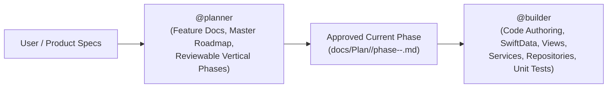

# Kurin Sub-Agents (`.agents/agent/`)

This directory contains sub-agent definitions for specialized roles in the Kurin project lifecycle.

## Role Separation & Workflow

Kurin enforces a strict separation between **Planning** and **Building**:

## Available Sub-Agents

| Agent | File | Responsibilities | Constraints |
| :--- | :--- | :--- | :--- |
| **@planner** | [`planner.md`](planner.md) | Retrieves passed plans, searches `docs/guide/` for source-traced formulas/rules/calculations and end-to-end sequencing, authors feature docs, and manages one feature-scoped roadmap with sequential user-reviewed phases. | **Strictly NO BUILD capabilities.** Cannot author Swift application code, run `xcodebuild`, or execute tests. |
| **@builder** | [`builder.md`](builder.md) | Implements features in `Kurin/` based strictly on verified plans from `@planner`. Authors SwiftData models, concrete Repositories & Services, `@Observable` ViewModels, SwiftUI Views, and AC-mapped unit tests. | Strictly executes verified plans from `@planner`. Must not alter `requirement.md` or `spec.md` without bouncing back to `@planner`. |

