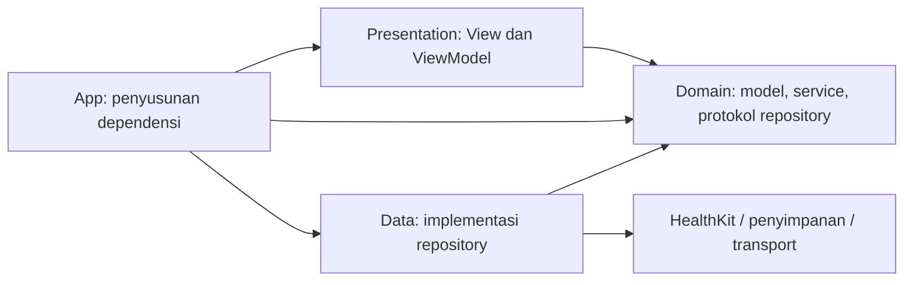

# Rule: Architecture & Code Quality

**Applies to:** All Swift source files  
**Mandatory:** Yes

---

## Project Structure

```text
Kurin/                             # Root repository
├── Kurin.xcodeproj/
│   ├── project.pbxproj
│   ├── project.xcworkspace/
│   └── xcuserdata/
└── Kurin/                         # Root source synced by Xcode
    ├── iOS/
    │   ├── App/
    │   │   ├── KurinApp.swift
    │   │   └── ContentView.swift
    │   ├── Core/
    │   │   ├── DesignSystem/
    │   │   └── Extensions/
    │   ├── Features/
    │   │   ├── AdaptivePlanning/
    │   │   ├── Onboarding/
    │   │   ├── Profile/
    │   │   ├── TrackingSession/
    │   │   └── TrainingProgress/
    │   ├── Resources/
    │   │   └── Assets.xcassets/
    │   └── Shared/
    │       ├── Data/
    │       ├── Domain/
    │       └── Presentation/
    └── WatchOS/
```

Every folder inside `Features/<Feature>/` and `Shared/` follows the same internal layout:

```text
Data/
├── Models/        # SwiftData @Model classes and Sendable value structs
└── Repositories/  # Concrete implementations of domain repository protocols
Domain/
├── Models/        # Framework-independent session, status, and metric types
├── Repositories/  # Protocols for recording and persistence boundaries
└── Services/      # Business logic; orchestrates one or more repositories
Presentation/
├── Coordinators/  # Navigation / flow coordination
├── SupportViews/  # Reusable sub-views scoped to this feature
├── ViewModels/    # @Observable view-models; call Services, never Repositories directly
└── Views/         # SwiftUI screens and components
```

> These folders are **source-code groupings inside a single Xcode target** — not separate Swift Packages, frameworks, or compilation modules. Boundaries between layers and features are enforced by convention and code review, not the build system.

---

## Layer Boundaries (Clean Architecture — Repo + Service)

```
View  →  ViewModel  →  Service  →  Repository  →  (HealthKit / SwiftData)
```

| Layer | Location | Responsibility | Rule |
|-------|----------|----------------|------|
| **View** | `Presentation/Views/`, `Presentation/SupportViews/` | Layout and data binding only | Zero business logic; reads from ViewModel only |
| **Coordinator** | `Presentation/Coordinators/` | Navigation flow between screens | No data fetching; push/pop/present Views only |
| **ViewModel** | `Presentation/ViewModels/` | UI state; calls Services | Use `@Observable`; never call a Repository directly |
| **Service** | `Domain/Services/` | Business rules; orchestrates Repositories | Pure Swift; depends on domain repository protocols, never concrete Data implementations |
| **Repository contract** | `Domain/Repositories/` | Defines recording and persistence capabilities required by the Domain | Protocols use framework-independent domain types only |
| **Repository implementation** | `Data/Repositories/` | Data access; maps raw types to domain models | Implements domain protocols using HealthKit or persistence; no business logic |
| **Domain model** | `Domain/Models/` | Session, status, and metric semantics | Pure Swift; no SwiftUI, HealthKit, or WatchConnectivity types |
| **Data model** | `Data/Models/` | DTOs and persistence representations | `@Model` for SwiftData entities; maps to and from domain models |

### Call Direction

```
View ──▶ ViewModel ──▶ Service ──▶ Repository ──▶ HealthKit / SwiftData
```

- A layer may **only call the layer immediately below it** — no skipping.
- Repository implementations are **concrete classes** that conform to narrowly scoped protocols defined by the Domain.
- Services are **concrete classes** injected into ViewModels via their initializer (constructor injection).

### Core vs Shared vs Feature

- Code used by **one feature only** lives inside that feature's folder hierarchy.
- Code used by **two or more features** moves to `Shared/` under the same `Data/Domain/Presentation` structure.
- `Core/DesignSystem/` contains application-wide visual primitives such as semantic colors, typography, spacing, and corner-radius tokens.
- `Core/Extensions/` contains general-purpose Swift and Foundation extensions.

---

## Responsible

### Presentation — MVVM

- `Views` dan `SupportViews` menampilkan informasi latihan dan menerima interaksi user.
- `ViewModels` menyediakan state tampilan, meneruskan aksi ke service domain, serta memetakan hasil dan error menjadi UI.
- `Coordinators`, bila diperlukan, mengatur navigasi; pengelolaan perekaman tetap berada di luar coordinator.

### Domain — Aturan Bisnis dan Kontrak

- `Models` mendefinisikan makna data sesi, status, serta metrik yang diperlukan fitur.
- `Services` menangani aturan transisi dan operasi sesi melalui protokol repository.
- `Repositories` mendefinisikan protokol akses perekaman atau penyimpanan yang dibutuhkan domain.
- Domain menggunakan tipe yang bebas dari SwiftUI, HealthKit, dan WatchConnectivity. Tipe framework dipetakan menjadi tipe domain oleh adapter di lapisan data.

### Data — Implementasi Integrasi

- `Repositories` mengimplementasikan protokol domain menggunakan HealthKit dan penyimpanan yang nantinya dipilih.
- `Models` menampung DTO atau representasi persistensi, dengan pemetaan ke model domain.
- Adapter framework mengelola callback, error, dan pengiriman perubahan sesi ke domain; ViewModel tidak mengakses objek HealthKit secara langsung.

### App — Penyusunan Dependensi

- Membuat implementasi repository, service, dan ViewModel, lalu memasangnya pada root view.
- Mempertahankan lifecycle komponen perekaman selama sesi aktif, terlepas dari pergantian view.
- Meneruskan konfigurasi yang diterima delegate ke alur aplikasi. Delegate tidak menyimpan seluruh aturan bisnis sesi.

Diagram berikut menunjukkan **arah dependensi kode**, bukan urutan pengiriman pesan antarperangkat:



Saat runtime, service menggunakan implementasi repository yang diinjeksi melalui protokol domain. Dengan demikian, Domain tetap tidak bergantung pada implementasi Data. Pemisahan folder perlu disertai disiplin dependensi ini; folder saja belum menjamin Clean Architecture.

---

## Protocol Abstraction Rule

> Protocols are required at Domain boundaries for recording, persistence, or framework integration. Services remain concrete unless multiple implementations create a demonstrated need for abstraction.

Rationale: Domain repository protocols enforce dependency inversion and prevent HealthKit, persistence, or transport types from leaking into business rules. Extra protocol pairs outside these integration boundaries increase boilerplate and indirection without improving isolation.

✅ Define narrow repository protocols in `Domain/Repositories/` using framework-independent types.  
✅ Implement those protocols with concrete classes in `Data/Repositories/`.  
✅ Keep Services concrete and use SwiftData in-memory containers for integration tests when appropriate.  
❌ Do **not** create matching `SomethingServiceProtocol` abstractions without multiple implementations or another demonstrated architectural need.

> **Code style, naming conventions, concurrency, SwiftUI, and documentation standards** are defined in  
> **[`05-code-style.md`](05-code-style.md)** — read that file alongside this one.

