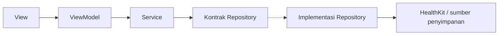
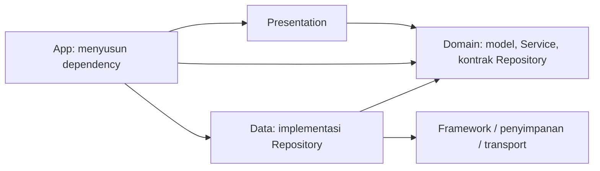
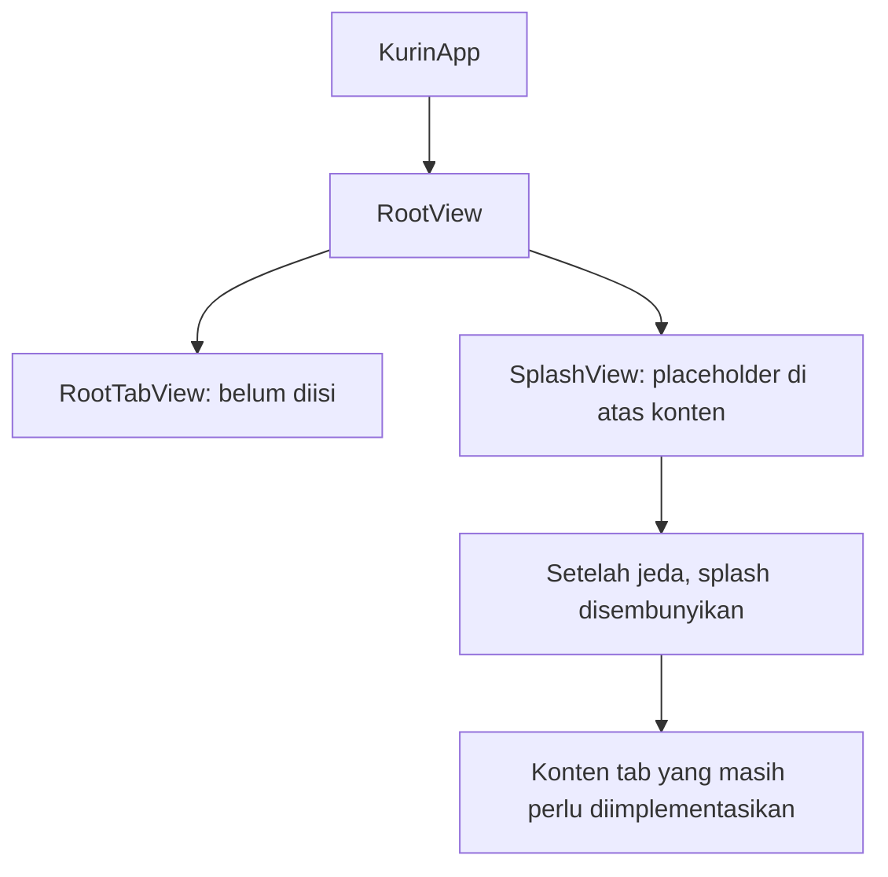
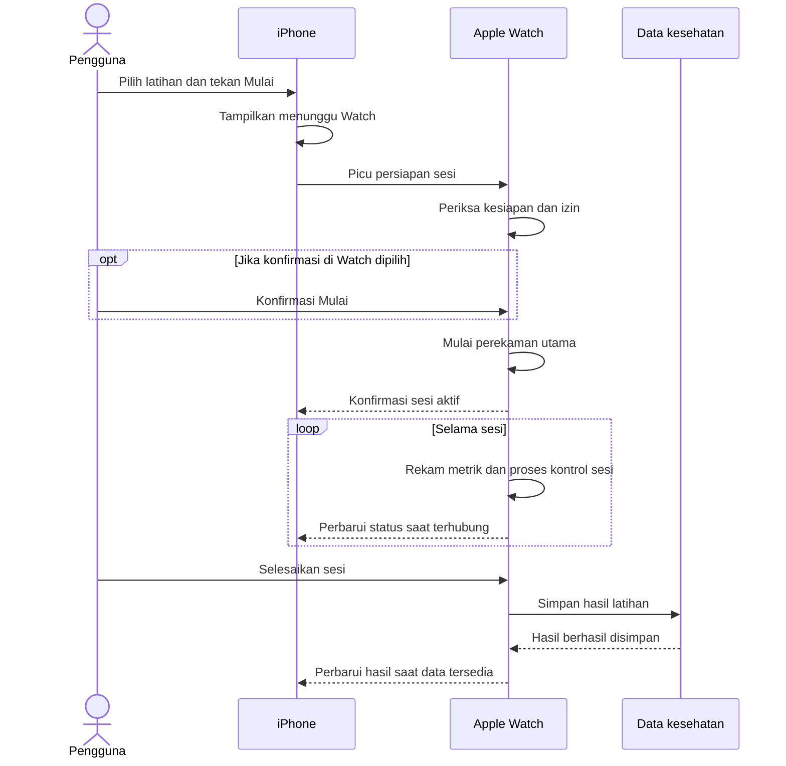

# Rule: Architecture & Code Quality

**Applies to:** All Swift source files  
**Mandatory:** Yes

---

## Project Structure

### Folder di repository

```text
Kurin/                                      # Root repository
├── ARCHITECTURE.md
├── Kurin.xcodeproj/
│   ├── project.pbxproj                     # Target, source membership, dan capability
│   ├── project.xcworkspace/
│   └── xcuserdata/
└── Kurin/                                  # Root source
    ├── iOS/
    │   ├── App/
    │   │   ├── KurinApp.swift              # Entry point aplikasi utama
    │   │   ├── RootView.swift              # Host awal; juga memuat RootTabView
    │   │   ├── SplashView.swift            # Tampilan splash, masih placeholder
    │   │   ├── AppCoordinator.swift        # Masih placeholder
    │   │   └── AppTabRoute.swift           # Masih placeholder
    │   ├── Core/
    │   │   ├── Domain/
    │   │   ├── Data/
    │   │   ├── DesignSystem/
    │   │   └── Extensions/
    │   ├── Features/
    │   │   ├── AdaptivePlanning/
    │   │   ├── Onboarding/
    │   │   ├── Profile/
    │   │   ├── TrackingSession/
    │   │   │   ├── Domain/
    │   │   │   ├── Data/
    │   │   │   └── Presentation/
    │   │   └── TrainingProgress/
    │   │       ├── Domain/
    │   │       └── Presentation/
    │   └── Resources/
    │       └── Assets.xcassets/
    └── WatchOS/
        ├── App/
        │   └── KurinWatchApp.swift         # Entry point aplikasi Watch
        ├── Features/
        │   └── TrackingSession/
        │       ├── Domain/
        │       ├── Data/
        │       └── Presentation/
        ├── Resources/
        │   └── Info.plist                 # Companion, deskripsi izin, dan background mode
        └── KurinWatch.entitlements         # Capability HealthKit
```

File ditempatkan langsung di **Domain**, **Data**, atau **Presentation**. Tidak diperlukan subfolder per jenis file pada tahap ini. Fitur yang belum dikembangkan tidak harus langsung memiliki seluruh lapisan; TrainingProgress dapat memakai akses data Core sehingga belum memiliki Data sendiri.

> Folder fitur merupakan pengelompokan source dalam target aplikasi masing-masing platform, bukan Swift Package atau modul kompilasi terpisah. Batas antarlapisan dan antarfitur dijaga melalui implementasi serta review kode.

Folder fitur dan Core masih kosong. Git belum melacak folder kosong karena tidak ada file penanda.

### Group di Xcode Project Navigator

```text
Kurin                                      # Project di Xcode
├── Kurin                                  # Source aplikasi
│   ├── iOS
│   └── WatchOS
├── Products                               # Referensi hasil build
│   ├── Kurin.app
│   └── KurinWatch.app
└── Frameworks                             # Referensi dependensi SDK
    └── HealthKit.framework
```

- **Products** menampilkan produk dari target Kurin dan KurinWatch. Bundle sebenarnya dibuat pada direktori output build Xcode, biasanya DerivedData; group dapat terlihat sebelum hasil build tersedia.
- **Frameworks** memuat referensi HealthKit dari SDK Apple, yang saat ini ditautkan ke target KurinWatch. Framework ini tidak disalin menjadi source di repository.
- Keduanya adalah group logis yang didefinisikan pada [project.pbxproj](Kurin.xcodeproj/project.pbxproj), bukan folder fisik tambahan di luar folder source.

## Layer Boundaries — Clean Architecture dengan Repository dan Service

### Alur pemanggilan



View menyampaikan aksi ke ViewModel. ViewModel menggunakan Service untuk menjalankan operasi fitur. Service memakai kontrak Repository milik Domain, sementara implementasinya mengakses sumber data dan mengembalikan model domain.

### Batas setiap komponen

- **View — Presentation:** layout, tampilan state, dan interaksi pengguna. Operasi bisnis serta akses data diteruskan melalui ViewModel.
- **ViewModel — Presentation:** loading, error, dan state layar. Menggunakan Service; tidak memanggil implementasi Repository atau framework data secara langsung.
- **Coordinator — App atau Presentation fitur:** perpindahan halaman dan alur navigasi. Tidak mengambil data atau memiliki logika perekaman.
- **Service — Domain:** aturan bisnis, validasi operasi, dan koordinasi satu atau beberapa kontrak Repository. Tidak bergantung pada implementasi Data.
- **Kontrak Repository — Domain:** batas kemampuan akses data, perekaman, atau penyimpanan yang dibutuhkan aturan bisnis. Menggunakan tipe domain yang bebas dari framework perangkat.
- **Implementasi Repository — Data:** query, akses perangkat, persistensi, dan pemetaan hasil ke model domain. Aturan bisnis tetap berada pada Service.
- **Model domain — Domain:** makna sesi, status, profil, atau metrik bagi aplikasi. Tidak membawa tipe SwiftUI, HealthKit, atau WatchConnectivity.
- **Model data — Data, bila diperlukan:** representasi khusus integrasi, transfer, atau penyimpanan. Dibuat hanya ketika kebutuhan formatnya berbeda dari model domain.

### Arah dependensi

Diagram sebelumnya menggambarkan pemanggilan saat runtime. Arah dependensi kode tetap menuju Domain:



App memberikan implementasi Repository kepada Service, lalu Service diberikan kepada ViewModel. Karena Service hanya mengetahui kontraknya, Domain tidak perlu mengimpor Data atau framework integrasi. Penyusunan dependency nantinya dilakukan langsung di KurinApp, tanpa container tambahan.

## Core vs Feature vs Platform

- Kode yang digunakan **satu fitur** ditempatkan pada fitur pemiliknya.
- Kode yang digunakan **beberapa fitur iOS** ditempatkan di Core iOS dengan pemisahan Domain dan Data sesuai tanggung jawabnya.
- **Core/DesignSystem** menampung fondasi visual bersama, seperti warna, tipografi, dan spacing.
- **Core/Extensions** menampung ekstensi umum yang diperlukan aplikasi.
- Source **iOS** dan **WatchOS** tetap dimiliki platform masing-masing. Tidak ada folder Shared atau Core di luar platform.
- Fitur boleh menggunakan Core; Core tidak bergantung pada implementasi fitur.

Model kesehatan lintas fitur iOS berada di **iOS/Core/Domain**. Akses HealthKit dan pemetaannya berada di **iOS/Core/Data**. Jika suatu model hanya dibutuhkan TrackingSession, tempatkan di Domain fitur tersebut.

Untuk pertukaran antarperangkat, kedua platform memiliki model pesan lokal pada Data fitur yang memakainya. Kesamaan format pesan dijaga sebagai kontrak komunikasi; tidak perlu berbagi file Swift untuk mengirim data.

## Responsibilities

### Presentation — MVVM

- View dan komponen pendukung menampilkan informasi serta menerima interaksi pengguna.
- ViewModel menyediakan state tampilan, menggunakan Service, dan memetakan hasil atau kegagalan menjadi UI.
- Coordinator mengatur navigasi pada cakupannya: App untuk alur aplikasi, atau Presentation fitur untuk alur internal fitur.
- Pergantian layar tidak menentukan lifecycle perekaman; sesi aktif tetap dimiliki komponen sesi.

### Domain — Aturan Bisnis dan Kontrak

- Model menjelaskan makna data yang dibutuhkan fitur.
- Service mengatur validasi serta operasi bisnis melalui kontrak Repository.
- Protokol Repository menyatakan kemampuan integrasi yang diperlukan Domain.
- Domain dapat digunakan dengan implementasi data berbeda tanpa membawa objek framework ke aturan bisnis.

### Data — Implementasi Integrasi

- Repository mengimplementasikan kontrak Domain menggunakan HealthKit, transport, atau penyimpanan yang nanti dipilih.
- Data dari framework dipetakan menjadi tipe domain sebelum dipakai Service dan Presentation.
- Callback serta error integrasi diteruskan melalui kontrak yang sesuai. Error tidak diam-diam diubah menjadi keberhasilan atau data kosong.
- DTO dan representasi persistensi ditambahkan saat dibutuhkan; teknologi penyimpanan lokal belum dipilih.

### App — Awal Aplikasi dan Penyusunan Dependency

- Entry point membuka RootView dan nantinya menyusun kebutuhan fitur langsung di KurinApp.
- RootView menjadi host tampilan awal dan navigasi.
- AppCoordinator diarahkan untuk mengatur navigasi aplikasi, sedangkan AppTabRoute diarahkan untuk menyatakan pilihan tab.
- Komponen sesi dipertahankan selama latihan berlangsung, terlepas dari halaman yang sedang terbuka.
- Pada Watch, konfigurasi mulai dari iPhone nantinya diteruskan ke alur sesi. Pengelolaan aturan bisnis tetap berada di Domain.

## Protocol Abstraction

Gunakan protokol pada **batas integrasi Domain**: perekaman, persistensi, atau akses framework. Kontrak diletakkan langsung di Domain dan implementasinya di Data.

Service tetap berupa tipe konkret yang menerima dependency melalui initializer. Protokol Service tambahan baru diperlukan jika ada kebutuhan nyata, seperti beberapa implementasi yang perlu dipertukarkan.

Pedoman ini menjaga isolasi aturan bisnis sambil membatasi abstraksi yang tidak diperlukan:

- Kontrak Repository memiliki cakupan sempit sesuai kebutuhan operasi.
- Kontrak menggunakan model netral, bukan objek SDK perangkat.
- Penyusunan objek berada pada App; ViewModel tidak membuat Repository konkret sendiri.
- Implementasi pengganti untuk preview atau pengujian mengikuti kontrak yang sama.

Pedoman ini merupakan arah pengembangan. Repository, Service, dan ViewModel fitur belum tersedia pada source saat ini.

## App Flow — Kondisi Saat Ini

Source aktual sudah menggunakan [KurinApp.swift](Kurin/iOS/App/KurinApp.swift) sebagai entry point yang membuka [RootView.swift](Kurin/iOS/App/RootView.swift).

RootView menyiapkan RootTabView dan menampilkan SplashView di atasnya saat awal aplikasi. Setelah jeda yang saat ini diatur sekitar dua detik, splash diarahkan untuk menghilang dengan animasi.



**Alur ini masih dalam pengerjaan:** RootTabView belum memiliki isi, SplashView masih berupa tampilan placeholder, dan AppCoordinator serta AppTabRoute saat ini juga masih berupa View placeholder. Nama file tersebut belum berarti koordinasi navigasi dan pemilihan tab sudah berfungsi.

Di Watch, KurinWatchApp sudah menjadi entry point dan menampilkan nama Kurin. Belum ada layar sesi atau komunikasi dengan iPhone yang dijalankan dari entry point tersebut.

## watchOS Setup — Sudah Tersedia

Project memiliki dua target dengan source membership terpisah:

- **Kurin** memakai folder iOS. Konfigurasi target utama juga mencakup macOS dan visionOS.
- **KurinWatch** memakai folder WatchOS. Saat build untuk iOS, aplikasi Watch disertakan dalam bundle aplikasi utama. Dependency Watch dibatasi pada platform iOS.

Konfigurasi Watch tersedia pada [KurinWatch.entitlements](Kurin/WatchOS/KurinWatch.entitlements) dan [Info.plist](Kurin/WatchOS/Resources/Info.plist):

- **HealthKit:** deklarasi akses data kesehatan yang nantinya diminta sesuai izin pengguna.
- **Workout processing:** dukungan background untuk sesi latihan aktif setelah logika workout diimplementasikan.
- **Deskripsi izin baca/tulis:** penjelasan tujuan penggunaan data kesehatan.
- **Companion identity:** mengaitkan aplikasi Watch dengan aplikasi utama.

Frameworks menampilkan HealthKit sebagai dependensi SDK Watch. Products menampilkan Kurin.app dan KurinWatch.app sebagai hasil target masing-masing.

Konfigurasi ini belum mencakup permintaan izin saat runtime, pengumpulan metrik, perekaman, penyimpanan hasil, atau sinkronisasi. Pengujian fungsional pada perangkat masih diperlukan saat fitur tersebut tersedia.

## Session Flow — Rancangan iPhone dan Watch

Watch menjadi pemilik sesi perekaman. iPhone menyiapkan pilihan latihan, memicu penggunaan Watch, dan menampilkan status yang sudah dikonfirmasi Watch.



Alur ini belum diimplementasikan. Keputusan mulai otomatis setelah Watch siap atau menunggu konfirmasi pengguna di Watch masih terbuka. iPhone baru menampilkan sesi sedang direkam setelah Watch menyatakan sesi benar-benar aktif.

Rancangan tampilan pendamping memakai workout mirroring: Watch memiliki sesi utama dan iPhone mengamatinya. Pembaruan state dan pengiriman metrik perlu ditangani sesuai kebutuhan tampilan. Berhentinya perekaman, tersimpannya hasil, dan tersedianya data di iPhone adalah tahapan yang berbeda.

## Data Exchange dan Failure Flow

Model domain serta pesan pertukaran data dimiliki masing-masing platform. Kontrak pesan menyepakati identitas sesi, field, tipe data, waktu, satuan, dan versi agar perangkat dengan versi aplikasi berbeda tetap dapat berkomunikasi sesuai kemampuan masing-masing.

- **Watch belum siap atau izin belum terpenuhi:** tampilkan arahan serta langkah pemulihan yang sesuai.
- **Menunggu terlalu lama:** periksa sesi yang mungkin sudah dimulai sebelum retry, agar permintaan berulang tidak menggandakan sesi.
- **Koneksi terputus:** Watch diarahkan untuk melanjutkan perekaman; iPhone menampilkan status koneksi dan informasi terakhir.
- **Koneksi kembali:** selaraskan status serta hasil berdasarkan identitas sesi yang sama, termasuk ketika pesan diterima ulang.
- **Penyimpanan atau pengiriman gagal:** tampilkan status sesuai hasil sebenarnya dan pertahankan informasi untuk pemulihan.

Transport, strategi persistensi lokal, dan mekanisme pemulihan belum diimplementasikan. iPhone sebagai perekam pengganti belum menjadi kebutuhan yang disampaikan.

Keputusan produk yang masih terbuka meliputi konfirmasi mulai, pembatalan saat menunggu Watch, data yang dibutuhkan setiap fitur, dan pengalaman Watch tanpa instalasi aplikasi iPhone. Dokumen perlu diperbarui saat keputusan tersebut atau implementasi nyata berubah.
