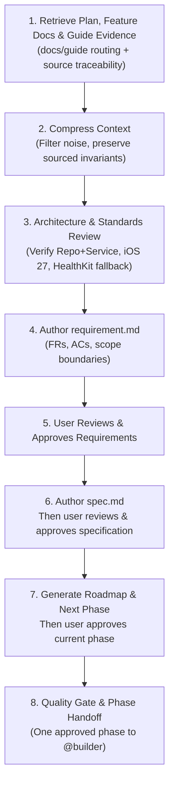

# Planner Skill: Feature Planning, Context Compression & Spec Authoring

This skill defines the complete operational procedure for utilizing the **@planner** sub-agent within the Kurin project. 

The `@planner` agent is an architect and analyst role with **strictly no build capabilities**. It generates feature documentation (`requirement.md` and `spec.md`) in `docs/Feature/` plus one feature-scoped master roadmap and sequential phase plans in `docs/Plan/` for execution by the **@builder** agent.

---

## 1. When to Use This Skill

Activate this skill when:
- Starting a new feature from `Kurin_Exercise_Guidance_v1.6.md` or a user feature prompt.
- Planning an end-to-end workflow that crosses multiple training phases or features.
- Resolving or validating an exact formula, rule, calculation, threshold, or decision sequence from `docs/guide/`.
- Reviewing or updating feature docs in `docs/Feature/<feature-id>-<feature-slug>/` or its matching roadmap and phase plans in `docs/Plan/<feature-id>-<feature-slug>/`.
- Large contexts (discussions, PR transcripts, long documentation) need compression before implementation.
- Converting high-level architectural proposals into a concrete, file-by-file workflow plan for `@builder`.
- Verifying whether a proposed change adheres to Kurin's Clean Architecture, platform constraints, and testing standards.

---

## 2. Operational Procedure for @planner

Follow this sequential 8-stage lifecycle when planning any feature:



### Mandatory Pre-Authoring Open-Decision Gate

Before Stage 4 writes or updates requirements, specifications, roadmaps, or phase plans, audit the retrieved evidence for missing, ambiguous, or conflicting decisions that could materially alter the documents. For each open decision:

1. Stop before authoring the dependent content.
2. Tell the user the precise question, the relevant or missing evidence, and the affected requirements, rules, acceptance criteria, or plan work.
3. Ask for an explicit decision. You may offer source-valid options and a clearly labeled recommendation, but must not choose on the user's behalf.
4. Wait for the user's answer; silence and recommendations are not approval.
5. Record the confirmed answer as an explicit, traceable user decision, close the open decision, and then resume authoring.

Run the same gate immediately if a new open decision appears during drafting. A material open decision must not remain merely documented while planning proceeds: it keeps the artifacts in draft and blocks review readiness, approval, and builder handoff.

### Stage 1: Retrieve Plan & Historical Context
1. Inspect `docs/README.md` and the assigned `docs/Feature/<feature-id>-<feature-slug>/` folder for scope, dependency order, and existing approved decisions.
2. Retrieve any passed plans, explicit user decisions, or prior design decisions from the active conversation or repository history.
3. Read `docs/guide/README.md` to route product-detail research. For an end-to-end workflow, also read `docs/guide/14-end-to-end-training-flow.md` to establish lifecycle order.
4. Search the relevant files under `docs/guide/` using the feature and domain terms, then read only the matched domain guides and direct prerequisites needed to interpret them.
5. Capture exact guide paths and headings for every formula, rule, calculation, threshold, boundary, ordering constraint, and fallback used by the plan.

#### Guide Retrieval & Evidence Protocol

- **Route, then retrieve:** Use `docs/guide/README.md` as the index. Use the end-to-end guide for phase order and the relevant domain guide for detailed behavior; a summary never replaces an available detailed source.
- **Create an evidence ledger:** Record the claim, exact guide path and heading, inputs, units, constants, operations, boundary conditions, rounding or precision, fallback, upstream dependencies, and downstream consumer.
- **Cross-check before authoring:** Compare guide evidence with the existing `requirement.md` and `spec.md`. Approved feature docs remain the builder-facing source of truth; `docs/guide/` is product evidence used by @planner to create or refine those docs.
- **Never silently resolve conflicts:** If feature docs and guide evidence disagree, preserve both citations, add a blocking open decision, and stop the handoff until an authoritative decision resolves the mismatch.
- **Never fill gaps by inference:** If no project source defines a value or behavior, record an open decision and ask the user to close it before authoring dependent content. Do not use template text, general knowledge, or web search as a substitute.
- **Trace the output:** Cite the exact guide file and section in the affected requirement, specification rule or formula, worked example, implementation-plan task, and verification mapping.

### Stage 2: Context Compression
Large documents and chat histories degrade agent precision. `@planner` must compress the context before drafting specifications:
- **Identify Invariants:** Extract exact, source-traced formulas, rules, calculations, data types, units, device constraints, thresholds, ordering, precision, boundaries, and fallback behavior.
- **Prune Conversational Noise:** Discard brainstorming transcripts, obsolete suggestions, and background chatter.
- **Normalize Terminology:** Align terms with Kurin domain language (`UserProfile`, `HealthScreening`, `TrainingPlan`, `ExerciseSession`, `RPE`, `TRIMP`, `WorkloadMetrics`).
- **Produce Compressed Context Summary:** Keep the distilled context to 1–2 pages maximum, organized by:
  - Core Goal
  - Data Requirements
  - Functional Invariants
  - Non-Functional / Platform Constraints
  - Out-of-Scope Items

### Stage 3: Architecture & Standards Review
Rigorously review the proposed design against project rules:
1. **Platform (Rule `01`):** iOS 27 (iPhone 17) & watchOS 11 (Series 11). Swift 6 concurrency (`async/await`, `@MainActor`, no `DispatchQueue`). HealthKit authorization denial must have manual fallback.
2. **Architecture (Rule `02`):** Single Xcode target. Clean Architecture with Repo + Service pattern. **Strictly no protocol abstraction** for Repositories or Services. ViewModels use `@Observable` and call Services only (never Repositories). Views contain zero business logic.
3. **Testing (Rule `03`):** Every Functional Requirement (`FR-XX`) must map to at least one Acceptance Criterion (`AC-XX`). Test methods must be named `test_AC01_<description>()`. Target ≥ 80% coverage on Domain Services.
4. **Docs-First (Rule `04`):** Features must be planned in dependency order. Downstream features must not assume models not yet specified upstream.
5. **Role Boundary:** Confirm `@planner` writes documentation only. **No Swift code in `Kurin/` or test execution is permitted.**
6. **Feature Boundary:** Confirm the feature docs and roadmap contain implementation ownership for exactly one feature. Downstream behavior is recorded only as an interface dependency or follow-up until its own feature is planned.

### Stage 4: Author `requirement.md`

Generate or update `docs/Feature/<feature-id>-<feature-slug>/requirement.md` using `.agents/template/requirement.md` for structure only. Populate it exclusively from authoritative sources, remove all template comments and placeholders, and include the feature objective, numbered FRs and ACs, and explicit out-of-scope boundaries.

Do not author dependent specification or plan content during this stage. If required information is absent or conflicting, invoke the open-decision gate, obtain the user's explicit decision, and record it before continuing.

### Stage 5: User Review and Requirement Approval

Present the completed `requirement.md` for user review and stop. Do not create or update `spec.md`, `roadmap.md`, or a phase plan until the user explicitly approves the requirements. Record the approval and its authority in `requirement.md`.

### Stage 6: Author, Review, and Approve `spec.md`

Only after requirement approval, generate or update `docs/Feature/<feature-id>-<feature-slug>/spec.md` using `.agents/template/spec.md` for structure only. Derive its data models, flow, validation, business rules, and dependencies from the approved requirements and authoritative evidence. Every formula, rule, calculation, state transition, boundary, and worked example must cite an exact project source.

Present the completed `spec.md` for user review and stop. Do not create or update the roadmap or phase plan until the user explicitly approves the specification. Record the approval and its authority in `spec.md`.

If specification work reveals a missing, ambiguous, or conflicting requirement, stop, return to `requirement.md`, close the decision with the user, and obtain renewed requirement approval before resuming specification work.

### Stage 7: Generate the Master Roadmap and Next Concrete Phase

Only after specification approval, create or update the implementation plan.

Create one directory for the current feature:

```text
docs/Plan/<feature-id>-<feature-slug>/
├── roadmap.md
└── phase-<sequence>-<phase-slug>.md
```

`roadmap.md` must contain:

- The feature goal and explicit scope boundary.
- Upstream inputs and downstream output contracts without implementing another feature.
- A dependency-ordered list of vertical, user-reviewable or independently verifiable phases.
- For each phase: covered FRs/ACs, dependencies, plan-review status, implementation status, verification status, and completion evidence.
- The status lifecycle `Draft → Ready for Review → Approved → In Progress → Verification → Complete`.

Outline the whole roadmap, but finalize only the next eligible phase plan. Do not detail Feature `N+1` while Feature `N` is still being defined unless the user explicitly requests cross-feature planning; even then, use separate roadmap directories.

Each `phase-<sequence>-<phase-slug>.md` must be tailored specifically for `@builder` consumption:

- **Vertical-slice outcome:** A user-visible or independently verifiable result, not a repository-wide horizontal layer.
- **Task ID:** 3-digit ID from `06a-create-branch.md` (e.g., `003`); distinct from the local phase sequence.
- **Target Git Branch:** `feat/<task-id>-<short-description>`.
- **Target File Map:** Exact paths for new and modified files across layers needed by this phase:
  - `Kurin/iOS/Features/<Feature>/Data/Models/<Model>.swift`
  - `Kurin/iOS/Features/<Feature>/Data/Repositories/<Repository>.swift`
  - `Kurin/iOS/Features/<Feature>/Domain/Services/<Service>.swift`
  - `Kurin/iOS/Features/<Feature>/Presentation/ViewModels/<ViewModel>.swift`
  - `Kurin/iOS/Features/<Feature>/Presentation/Views/<View>.swift`
  - `Kurin/iOS/Features/<Feature>/Presentation/SupportViews/<SubView>.swift`
  - `KurinTests/<Feature>Tests/<Feature>Tests.swift`
- **Layer-by-Layer Task Breakdown:** Atomic, dependency-ordered tasks inside the vertical slice (Data → Domain → Presentation → Tests, omitting layers the phase genuinely does not need).
- **AC Coverage Table:**
  | AC Number | Acceptance Criteria Summary | Target Test Method |
  | :---: | :--- | :--- |
  | `<AC-ID>` | `<source-backed criterion summary>` | `<test method from the concrete plan>` |
- **Guide Evidence:** Add the exact `docs/guide/` path and section to every task implementing a retrieved formula, rule, calculation, or end-to-end transition.
- **Approval Gate:** Set `Ready for Review` only when sources and blockers are resolved. Do not hand the phase to `@builder` until the user approves it and earlier phases are complete.

If roadmap or phase planning reveals a requirement or specification gap, stop, return to the affected upstream artifact, obtain renewed approval, and revalidate every dependent artifact before continuing.

Present the current phase plan for explicit user approval and record that approval in the roadmap before handoff.

### Stage 8: Quality Gate & Handoff to @builder
Verify all checks pass before transmitting one phase to `@builder`:
- [x] Context compressed into concise requirements without loss of critical formulas.
- [x] `requirement.md` received explicit user approval before `spec.md` authoring began.
- [x] `spec.md` received explicit user approval before roadmap or phase-plan authoring began.
- [x] Every formula, rule, calculation, threshold, and end-to-end transition has an exact guide or approved feature-doc citation.
- [x] No unresolved conflict exists between approved feature docs and `docs/guide/`; unresolved gaps remain explicit blocking decisions.
- [x] `requirement.md` has numbered `FR-XX` and `AC-XX`.
- [x] `spec.md` has data models, validation rules, and flow.
- [x] The master roadmap contains exactly one feature's implementation scope and records downstream work only as dependencies.
- [x] The current phase is a reviewable vertical slice with exact file paths, internal layer ordering, and AC-to-test mapping.
- [x] The user approved the current phase and every preceding phase is marked `Complete`.
- [x] Adheres strictly to Repo + Service without protocols.
- [x] No build commands or code implementation attempted by `@planner`.

After `@builder` finishes, it reports build, test, AC, and review evidence without editing `docs/`. `@planner` audits that evidence and marks the phase `Complete` in `roadmap.md` only when every completion condition is satisfied. The next phase remains locked until then.

---

## 3. Standard Handoff Format for @builder

When transferring the task to `@builder`, provide the following concise payload:

```markdown
### 🚀 Ready for Builder Execution: <Feature Name> — Phase <sequence> (Task ID: <XXX>)

**Documentation References:**
- Requirements: `docs/Feature/<feature-id>-<feature-slug>/requirement.md`
- Technical Spec: `docs/Feature/<feature-id>-<feature-slug>/spec.md`
- Master Roadmap: `docs/Plan/<feature-id>-<feature-slug>/roadmap.md`
- Current Phase Plan: `docs/Plan/<feature-id>-<feature-slug>/phase-<sequence>-<phase-slug>.md`

**Guide Evidence:**
- `docs/guide/<guide-file>.md` — `<section heading>`: `<rule/formula/calculation used>`

**Branch to Create:** `feat/<task-id>-<feature-slug>`

**Execution Sequence for @builder (current approved phase only):**
1. Create Data Models & Repositories (concrete classes, SwiftData/structs).
2. Create Domain Service with business logic & calculations.
3. Create @Observable ViewModel injecting Service via init.
4. Build SwiftUI Views adhering to DesignSystem.
5. Implement unit tests covering AC-01 through AC-XX (`test_AC01_...`).
6. Add DocC comments (`///`) to all internal symbols.

**Completion Return:** Report implementation and verification evidence to `@planner`. Do not edit roadmap statuses; `@planner` verifies the evidence and unlocks the next phase.
```

