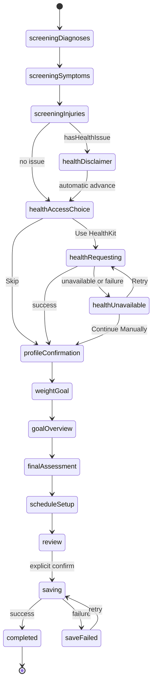

# Technical Specification — Integrated Onboarding, Health Profile, Assessment, and Initial Plan

> **Feature ID:** `001`  
> **Feature directory:** `docs/Feature/001-onboarding-health-profile/`  
> **Source requirements:** [`requirement.md`](requirement.md) — approved by explicit user decision on 2026-11-10  
> **Prepared by:** `@planner`  
> **Status:** `Approved — explicit user approval recorded 2026-11-10`
> **Approval authority:** Explicit user approval, 2026-11-10; roadmap authoring is authorized subject to workspace and branch-base prerequisites.

## 1. Scope and Layer Placement

Feature 001 owns the first-run flow from diagnoses screening through successful local persistence of the confirmed
Initial Training Plan. Feature IDs 002 and 003 remain reserved and have no separate implementation.

The paths below follow the canonical single-target layout in `AGENTS.md`. The implementation workspace is not present
in this checkout, so the paths and target membership must be reconciled against the restored Xcode project before a
phase can be handed to `@builder`.

| Responsibility | Layer | Target path | Governing requirement |
|---|---|---|---|
| Domain-neutral onboarding values and SwiftData persistence models | Data / Models | `Kurin/iOS/Features/Onboarding/Data/Models/` | `FR-02`–`FR-31` |
| Read-only DOB, height, and body-mass access | Data / Repository | `Kurin/iOS/Features/Onboarding/Data/Repositories/HealthDataRepository.swift` | `FR-07`–`FR-12` |
| Atomic completed-onboarding persistence | Data / Repository | `Kurin/iOS/Features/Onboarding/Data/Repositories/OnboardingRepository.swift` | `FR-29`–`FR-31` |
| Screening, profile/BMI, goal, assessment, plan, and completion rules | Domain / Services | `Kurin/iOS/Features/Onboarding/Domain/Services/` | `FR-02`–`FR-31` |
| Ordered state and user-event orchestration | Presentation / ViewModel | `Kurin/iOS/Features/Onboarding/Presentation/ViewModels/OnboardingViewModel.swift` | `FR-01`–`FR-31` |
| First-run navigation | Presentation / Coordinator | `Kurin/iOS/Features/Onboarding/Presentation/Coordinators/OnboardingCoordinator.swift` | `FR-01`, `FR-30`, `FR-31` |
| Accessible onboarding screens and feature-scoped components | Presentation / Views | `Kurin/iOS/Features/Onboarding/Presentation/Views/` and `SupportViews/` | `NFR-01`, `NFR-03` |
| Concrete dependency construction | App composition | `Kurin/iOS/App/KurinApp.swift` | `NFR-03` |
| AC-mapped verification | iOS test target | `KurinTests/Onboarding/` | `AC-01`–`AC-31`, `NFR-05` |

All repositories and services are concrete types. No repository or service protocol is permitted.

## 2. Data Model

### Types

| Type | Kind | Persistence | Ownership | Source |
|---|---|---|---|---|
| `ScreeningStage` | String-backed enum | No | Data / Models | `FR-02` |
| `ScreeningOption` | `Sendable` value struct | Static v1 catalog | Data / Models | `FR-02`, requirement §8 |
| `ScreeningStageSelection` | `Sendable` value struct | In-memory draft; IDs copied on completion | Data / Models | `FR-02`–`FR-04` |
| `HealthScreeningDraft` | `Sendable` value struct | In-memory draft; IDs copied on completion | Data / Models | `FR-02`–`FR-06` |
| `ProfileValueSource` | String-backed enum | Stored | Data / Models | `FR-12` |
| `HealthProfileSnapshot` | `Sendable` value struct | Ephemeral | Data / Models | `FR-07`–`FR-11` |
| `ConfirmedProfile` | `Sendable` value struct | Copied into completed record | Data / Models | `FR-12`–`FR-15` |
| `BMIClassification` | String-backed enum | Stored | Data / Models | `FR-15` |
| `BMIResult` | `Sendable` value struct | Copied into completed record | Data / Models | `FR-14`, `FR-15` |
| `WeightGoalOverview` | `Sendable` value struct | Copied into completed record | Data / Models | `FR-16`, `FR-17` |
| `TrainingType` | String-backed enum | Stored | Data / Models | `FR-18`–`FR-20` |
| `Weekday` | Integer-backed enum, Monday = 1 through Sunday = 7 | Stored as integers | Data / Models | `FR-22`–`FR-26` |
| `LocalDate` | `Sendable`, `Comparable` value struct | Encoded as Gregorian `YYYY-MM-DD` text | Data / Models | `FR-13`, `FR-23`–`FR-27` |
| `StartTimingChoice` | Enum | In-memory only | Data / Models | `FR-24`, `FR-25` |
| `ScheduleConfiguration` | `Sendable` value struct | Copied into completed record | Data / Models | `FR-20`–`FR-27` |
| `InitialTrainingSession` | `Sendable` value struct | Stored as child model data | Data / Models | `FR-26`–`FR-29` |
| `InitialTrainingPlan` | `Sendable` value struct | Copied into completed record | Data / Models | `FR-26`–`FR-29` |
| `OnboardingDraft` | `Sendable` value struct | Memory only; never restored | Data / Models | `FR-28`–`FR-31` |
| `OnboardingRecord` | SwiftData `@Model` aggregate root | Local persistent store | Data / Models | `FR-29`–`FR-31` |
| `OnboardingSessionRecord` | SwiftData `@Model` child | Local persistent store | Data / Models | `FR-26`, `FR-29` |
| `OnboardingStage` | Associated-value enum | ViewModel memory only | Presentation | `FR-01`–`FR-31` |

### Fields or Cases

| Parent type | Name | Swift type or raw value | Optional | Constraints | Source |
|---|---|---|:---:|---|---|
| `ScreeningStage` | cases | `diagnoses`, `activeSymptoms`, `ongoingInjuries` | No | Fixed order | `FR-02` |
| `ScreeningOption` | `id` | `String` | No | Exact authoritative v1 ID | Requirement §8 |
| `ScreeningOption` | `label` | `String` | No | Exact authoritative v1 label | Requirement §8 |
| `ScreeningOption` | `isNone` | `Bool` | No | True only for the stage's `.none` ID | `FR-02`, `FR-03` |
| `ScreeningStageSelection` | `stage` | `ScreeningStage` | No | One selection value per stage | `FR-02` |
| `ScreeningStageSelection` | `selectedIDs` | `Set<String>` | No | Nonempty; either the exclusive None ID or one or more positive IDs | `FR-02`, `FR-03` |
| `HealthScreeningDraft` | `diagnoses/symptoms/injuries` | `ScreeningStageSelection` | No | One value for each ordered stage | `FR-02` |
| `HealthScreeningDraft` | `hasHealthIssue` | Computed `Bool` | No | True iff any selected ID is not a None ID | `FR-04` |
| `ProfileValueSource` | cases | `health = "HEALTH"`, `manual = "MANUAL"` | No | Stored per required profile value | `FR-12` |
| `HealthProfileSnapshot` | `dateOfBirth` | `LocalDate?` | Yes | Readable HealthKit characteristic only | `FR-07`, `FR-11` |
| `HealthProfileSnapshot` | `heightCentimeters` | `Double?` | Yes | Readable HealthKit height only | `FR-07`, `FR-11` |
| `HealthProfileSnapshot` | `bodyWeightKilograms` | `Double?` | Yes | Readable HealthKit body mass only | `FR-07`, `FR-11` |
| `ConfirmedProfile` | `dateOfBirth` | `LocalDate` | No | Valid past date; no age gate | `FR-13` |
| `ConfirmedProfile` | `heightCentimeters` | `Double` | No | Greater than zero | `FR-13` |
| `ConfirmedProfile` | `bodyWeightKilograms` | `Double` | No | Greater than zero | `FR-13` |
| `ConfirmedProfile` | source fields | `ProfileValueSource` × 3 | No | One source for DOB, height, and weight | `FR-12` |
| `BMIResult` | `unroundedValue` | `Double` | No | Positive; used for class and assignment | `FR-14`, `FR-15` |
| `BMIResult` | `classification` | `BMIClassification` | No | Continuous approved categories | `FR-15` |
| `WeightGoalOverview` | `targetKilograms` | `Double` | No | Greater than zero; not constrained to range | `FR-16` |
| `WeightGoalOverview` | `recommendedMinimum/Maximum` | `Double` | No | Raw Double values; UI displays one decimal | `FR-16`, `FR-17` |
| `TrainingType` | cases | `easyWalking`, `hrZone2Activity` | No | Assigned, never user-selected | `FR-18`, `FR-19` |
| `LocalDate` | `year/month/day` | `Int` × 3 | No | Valid Gregorian date; no time or time zone | `FR-27` |
| `StartTimingChoice` | cases | `today`, `sameDayNextWeek`, `nearestFutureDay` | No | Allowed by weekday relation | `FR-24`, `FR-25` |
| `ScheduleConfiguration` | `frequencyPerWeek` | `Int` | No | Easy Walking = 3; Zone 2 ∈ {3,4,5} | `FR-20`, `FR-21` |
| `ScheduleConfiguration` | `durationMinutes` | `Int` | No | Easy Walking = 15; Zone 2 approved 5-minute set | `FR-20`, `FR-21` |
| `ScheduleConfiguration` | `weekdays` | `Set<Weekday>` | No | Unique count equals frequency | `FR-22` |
| `ScheduleConfiguration` | `selectedStartWeekday` | `Weekday` | No | Member of `weekdays` | `FR-23` |
| `ScheduleConfiguration` | `resolvedStartDate` | `LocalDate` | No | Never past | `FR-23`–`FR-27` |
| `InitialTrainingSession` | `scheduledDate` | `LocalDate` | No | Selected date in plan coverage | `FR-26`, `FR-27` |
| `InitialTrainingSession` | `durationMinutes` | `Int` | No | Inherited from schedule | `FR-20`, `FR-21` |
| `InitialTrainingPlan` | `trainingType` | `TrainingType` | No | Final Assessment output | `FR-18`, `FR-19` |
| `InitialTrainingPlan` | `weekStart/weekEnd` | `LocalDate` × 2 | No | Monday and Sunday | `FR-26` |
| `InitialTrainingPlan` | `sessions` | `[InitialTrainingSession]` | No | Ordered ascending; one or more dates | `FR-26` |
| `OnboardingRecord` | `completedAt` | `Date` | No | Written only in successful atomic save | `FR-29`, `FR-30` |
| `OnboardingRecord` | screening ID arrays | `[String]` × 3 | No | Approved selected IDs, including None where selected | `FR-02`–`FR-04` |
| `OnboardingRecord` | `hasHealthIssue` | `Bool` | No | Evaluation of persisted screening IDs | `FR-04` |
| `OnboardingRecord` | `dateOfBirthISODate` | `String` | No | Gregorian `YYYY-MM-DD`; valid past date | `FR-12`, `FR-13` |
| `OnboardingRecord` | `dateOfBirthSourceRaw` | `String` | No | `HEALTH` or `MANUAL` | `FR-12` |
| `OnboardingRecord` | `heightCentimeters`, `bodyWeightKilograms` | `Double` × 2 | No | Positive confirmed values | `FR-12`, `FR-13` |
| `OnboardingRecord` | `heightSourceRaw`, `bodyWeightSourceRaw` | `String` × 2 | No | `HEALTH` or `MANUAL` | `FR-12` |
| `OnboardingRecord` | `unroundedBMI`, `bmiClassificationRaw` | `Double`, `String` | No | Exact approved BMI output | `FR-14`, `FR-15` |
| `OnboardingRecord` | `targetWeightKilograms`, `recommendedMinimumKilograms`, `recommendedMaximumKilograms` | `Double` × 3 | No | Raw confirmed/calculated values | `FR-16`, `FR-17` |
| `OnboardingRecord` | `trainingTypeRaw` | `String` | No | `easyWalking` or `hrZone2Activity` | `FR-18`, `FR-19` |
| `OnboardingRecord` | `frequencyPerWeek`, `durationMinutes` | `Int` × 2 | No | Validated assigned-track values | `FR-20`, `FR-21` |
| `OnboardingRecord` | `weekdayRawValues` | `[Int]` | No | Unique Monday = 1 through Sunday = 7 | `FR-22` |
| `OnboardingRecord` | `selectedStartWeekdayRaw` | `Int` | No | Member of `weekdayRawValues` | `FR-23` |
| `OnboardingRecord` | `resolvedStartISODate`, `weekStartISODate`, `weekEndISODate` | `String` × 3 | No | Gregorian `YYYY-MM-DD` date-only values | `FR-23`–`FR-27` |
| `OnboardingRecord` | `sessions` | `[OnboardingSessionRecord]` | No | Cascade-owned ordered children | `FR-26`, `FR-29` |
| `OnboardingSessionRecord` | `scheduledISODate` | `String` | No | Gregorian `YYYY-MM-DD`; no time zone | `FR-27` |
| `OnboardingSessionRecord` | `durationMinutes` | `Int` | No | Approved schedule duration | `FR-20`, `FR-21` |

### Authoritative V1 Catalogs

| Stage | Positive option | Exclusive None option |
|---|---|---|
| Diagnosed conditions | `diagnosis.pending-product-01` — “Diagnosis option pending Product/Clinical review” | `diagnosis.none` — “None” |
| Active symptoms | `symptom.pending-product-01` — “Symptom option pending Product/Clinical review” | `symptom.none` — “None” |
| Ongoing injuries | `injury.pending-product-01` — “Injury option pending Product/Clinical review” | `injury.none` — “None” |

Source: approved `requirement.md` §8, user approval 2026-11-10.

### Relationships and Lifecycle

- `OnboardingDraft` owns screening, profile, goal, assignment, schedule, and generated plan values in memory only.
- No incomplete draft is written to SwiftData. If the process relaunches without an `OnboardingRecord`, the flow starts
  at diagnoses.
- One `OnboardingRecord` owns one or more `OnboardingSessionRecord` children. The record and every child are inserted
  and saved in one SwiftData transaction; any failure rolls back the attempted aggregate.
- Domain-facing dates are `LocalDate` values. Persistence encodes them as Gregorian `YYYY-MM-DD`; no conversion from a
  stored absolute instant occurs, so a time-zone change cannot alter the calendar day.
- `HealthProfileSnapshot` is discarded after profile confirmation. Only confirmed values and provenance are persisted.
- No model contains HR, RHR, HRV, SpO₂, respiratory rate, calories, steps, distance, or activity duration.
- This is the first approved schema for Feature 001; no migration from a prior production schema is required.

## 3. Flow and State Machine

### States

| State | Meaning | Entry condition | Exit condition | Source |
|---|---|---|---|---|
| `screeningDiagnoses` | Select from the v1 diagnoses catalog. | New or restarted onboarding | Valid selection confirms | `FR-01`–`FR-03` |
| `screeningSymptoms` | Select from the v1 symptoms catalog. | Diagnoses confirm | Valid selection confirms | `FR-02`, `FR-03` |
| `screeningInjuries` | Select from the v1 injuries catalog. | Symptoms confirm | Valid selection confirms | `FR-02`–`FR-04` |
| `healthDisclaimer` | Display exact v1 informational text. | `hasHealthIssue == true` | System advances after presentation; no user acknowledgement | `FR-05`, `FR-06` |
| `healthAccessChoice` | Offer Use HealthKit or Skip. | Screening path completes | User chooses one action | `FR-07`, `FR-08` |
| `healthRequesting` | Request/fetch only DOB, height, body mass. | User chooses HealthKit or Retry | Request/query completes or fails | `FR-07`–`FR-11` |
| `healthUnavailable` | Offer Retry and Continue Manually with privacy-safe copy. | HealthKit unavailable/request/query failure | User chooses recovery | `FR-09`, `FR-10` |
| `profileConfirmation` | Confirm prefilled/manual required profile values. | Skip, successful fetch, or Continue Manually | Valid profile confirms | `FR-08`–`FR-15` |
| `weightGoal` | Enter a positive target weight. | Profile confirms | Positive target confirms | `FR-16` |
| `goalOverview` | Show profile, BMI, target, and informational range. | Goal calculation completes | User continues | `FR-17` |
| `finalAssessment` | Assign training type and allowed configuration. | Overview continues | Deterministic assignment completes | `FR-18`–`FR-21` |
| `scheduleSetup` | Select allowed duration/frequency, weekdays, and start. | Assessment completes | Valid plan generates | `FR-20`–`FR-27` |
| `review` | Display the complete generated plan. | Plan generation completes | User explicitly confirms | `FR-28`, `FR-29` |
| `saving` | Persist the completed aggregate atomically. | Review confirms or retry begins | Save succeeds or fails | `FR-29`, `FR-30` |
| `saveFailed` | Show recoverable same-flow failure. | Atomic save throws | User retries | `FR-30` |
| `completed` | Completion is recorded and app may leave onboarding. | Atomic save succeeds | Terminal for Feature 001 | `FR-30` |

### Transitions

| Current state | Event | Guard | Next state | Side effect | AC |
|---|---|---|---|---|---|
| App launch | Start onboarding | No completed record | `screeningDiagnoses` | Create in-memory draft only | `AC-01`, `AC-31` |
| Any screening stage | Toggle None | None chosen | Same stage | Clear all positive IDs | `AC-02` |
| Any screening stage | Toggle positive option | Approved ID | Same stage | Clear None and update positive set | `AC-03` |
| `screeningDiagnoses` | Confirm | Valid selection | `screeningSymptoms` | Store stage selection in draft | `AC-01`–`AC-03` |
| `screeningSymptoms` | Confirm | Valid selection | `screeningInjuries` | Store stage selection in draft | `AC-01`–`AC-03` |
| `screeningInjuries` | Confirm | `hasHealthIssue` | `healthDisclaimer` | Store selection and issue result | `AC-03`, `AC-04` |
| `screeningInjuries` | Confirm | No health issue | `healthAccessChoice` | Store selection and issue result | `AC-02`, `AC-05` |
| `healthDisclaimer` | Automatic advance after presentation | None | `healthAccessChoice` | No acknowledgement or stored acknowledgement | `AC-04` |
| `healthAccessChoice` | Use HealthKit | None | `healthRequesting` | Begin exact read request/fetch | `AC-06` |
| `healthAccessChoice` | Skip | None | `profileConfirmation` | Create empty snapshot; require manual values | `AC-07` |
| `healthRequesting` | Fetch succeeds | Any readable subset | `profileConfirmation` | Prefill readable values only | `AC-09`, `AC-10` |
| `healthRequesting` | Unavailable/request/query failure | None | `healthUnavailable` | Preserve privacy-safe failure category | `AC-08` |
| `healthUnavailable` | Retry | None | `healthRequesting` | Retry exact request/fetch | `AC-08` |
| `healthUnavailable` | Continue Manually | None | `profileConfirmation` | Create empty snapshot | `AC-08` |
| `profileConfirmation` | Edit value | Valid candidate | Same state | Set edited value source to `MANUAL` | `AC-11` |
| `profileConfirmation` | Confirm | Valid past DOB; positive height/weight | `weightGoal` | Calculate unrounded BMI/category | `AC-12`–`AC-14` |
| `weightGoal` | Confirm | Target > 0 | `goalOverview` | Calculate raw target range | `AC-15`, `AC-16` |
| `goalOverview` | Continue | None | `finalAssessment` | None | `AC-15` |
| `finalAssessment` | Evaluate | No issue and BMI < 30 | `scheduleSetup` | Assign HR Zone 2 constraints | `AC-17`, `AC-21` |
| `finalAssessment` | Evaluate | Issue or BMI ≥ 30 | `scheduleSetup` | Assign Easy Walking 3 × 15 | `AC-18`–`AC-20` |
| `scheduleSetup` | Generate plan | Valid configuration/start | `review` | Create ordered date-only sessions | `AC-20`–`AC-28` |
| `review` | Confirm | Plan is valid | `saving` | Begin atomic save; no review-edit loop | `AC-29`, `AC-30` |
| `saving` | Save succeeds | None | `completed` | Persist completion timestamp | `AC-29` |
| `saving` | Save fails | None | `saveFailed` | Roll back attempted aggregate; retain in-memory draft | `AC-30` |
| `saveFailed` | Retry | In-memory draft exists | `saving` | Retry atomic save | `AC-30` |
| App relaunch | Start onboarding | No completed record | `screeningDiagnoses` | Discard prior process memory | `AC-31` |

### Diagram

## 4. Validation Rules and Boundaries

| Input | Type / format | Unit | Allowed values or boundary | Validation owner | Invalid behavior | Source |
|---|---|---|---|---|---|---|
| Catalog option ID | `String` | None | Exact ID in its authoritative v1 stage catalog | `HealthScreeningService` | Reject unknown ID; remain on stage | `FR-02`, requirement §8 |
| Stage selection | `Set<String>` | None | Exclusive None ID or one-or-more positive IDs; never both | `HealthScreeningService` | Prevent confirmation | `FR-02`, `FR-03` |
| HealthKit read set | HealthKit object types | None | DOB via `dateOfBirthComponents()`; `HKQuantityTypeIdentifier.height`; `HKQuantityTypeIdentifier.bodyMass` only | `HealthDataRepository` | Do not request broader type | `FR-07`; Guide 17 §1.2 |
| Date of birth | `LocalDate` | Gregorian date | Strictly before current local date; no age range | `HealthProfileService` | Prevent profile confirmation | `FR-13` |
| Height | `Double` | cm | `> 0` | `HealthProfileService` | Prevent profile confirmation | `FR-13` |
| Current body weight | `Double` | kg | `> 0` | `HealthProfileService` | Prevent profile confirmation | `FR-13` |
| Target weight | `Double` | kg | `> 0`; no recommended-range gate | `WeightGoalService` | Prevent goal confirmation | `FR-16` |
| Frequency | `Int` | sessions/week | Easy Walking = 3; Zone 2 ∈ {3,4,5} | `InitialPlanService` | Prevent plan generation | `FR-20`, `FR-21` |
| Duration | `Int` | min/session | Easy Walking = 15; Zone 2 = 5-minute values from 15 through 300/frequency | `InitialPlanService` | Prevent plan generation | `FR-20`, `FR-21` |
| Weekdays | `Set<Weekday>` | None | Unique count exactly equals frequency | `InitialPlanService` | Prevent plan generation | `FR-22` |
| Start weekday | `Weekday` | None | Member of selected weekdays | `InitialPlanService` | Prevent plan generation | `FR-23` |
| Resolved start | `LocalDate` | Gregorian date | Current local date or future; approved same/different weekday rule | `InitialPlanService` | Prevent plan generation | `FR-23`–`FR-26` |
| Persisted session date | `YYYY-MM-DD` | Gregorian date | Lossless encoding of a valid `LocalDate` | `OnboardingRepository` | Abort and roll back save | `FR-27`, `FR-30` |

## 5. Business Logic and Calculations

### Rule: Screening Selection and Health Issue

| Item | Definition | Source |
|---|---|---|
| Inputs | Three stage selections containing authoritative v1 IDs | `FR-02`–`FR-04` |
| Rule | None is exclusive per stage. `hasHealthIssue = true` iff any selected ID is not that stage's None ID. | `FR-03`, `FR-04` |
| Output | `Bool hasHealthIssue` plus conditional disclaimer branch | `FR-04`, `FR-05` |
| Precision | Exact set membership | `FR-03` |
| Exceptional behavior | Unknown IDs or None mixed with positives are invalid | `FR-02`, `FR-03` |

Example: diagnoses = `diagnosis.none`, symptoms = `symptom.pending-product-01`, injuries =
`injury.none` produces `hasHealthIssue == true`, Easy Walking, and the exact v1 disclaimer.

### Formula: BMI and Classification

| Item | Definition | Source |
|---|---|---|
| Inputs | Height in centimeters `> 0`; current weight in kilograms `> 0` | Guide 17 §1.2; `FR-13` |
| Rule / formula | `heightMeters = heightCentimeters / 100`; `BMI = weightKilograms / heightMeters²` | Guide 17 §1; `FR-14` |
| Output | Raw `Double` BMI and one category | `FR-14`, `FR-15` |
| Precision | Retain unrounded Double for class/assignment; display one decimal using nearest rounding, with .05 ties upward for positive values as in Guide 17 §3.1 | Guide 17 §§1, 3.1, 3.3 |
| Exceptional behavior | Invalid nonpositive input is rejected before calculation | `FR-13` |

Classification: underweight `< 18.5`; normal `18.5..<25`; overweight `25..<30`; obesity `≥ 30`.
For 170 cm and 86.7 kg: `86.7 / 1.70² = 30.0` → obesity → Easy Walking.

### Formula: Recommended Target-Weight Range

| Item | Definition | Source |
|---|---|---|
| Inputs | Confirmed height in meters; positive target weight | `FR-16` |
| Rule / formula | `minimum = 18.5 × heightMeters²`; `maximum = 24.9 × heightMeters²` | Guide 17 §3.1 |
| Output | Raw Double bounds plus one-decimal display values | `FR-16`, `FR-17` |
| Precision | Store raw Double; display one decimal using the same positive nearest/ties-up policy | Guide 17 §3.1; `FR-16` |
| Exceptional behavior | Target outside the range remains valid; target `≤ 0` is invalid | `FR-16` |

For 170 cm: `18.5 × 1.70² = 53.465 → 53.5 kg`; `24.9 × 1.70² = 71.961 → 72.0 kg`.

### Rule: Training Type and Schedule Bounds

| Item | Definition | Source |
|---|---|---|
| Inputs | `hasHealthIssue`, unrounded BMI, requested Zone 2 frequency/duration | `FR-18`–`FR-21` |
| Rule | No issue and BMI < 30 → HR Zone 2; otherwise Easy Walking. Easy Walking = 3 × 15. Zone 2 F ∈ {3,4,5}; D ∈ {15,20,…,300/F}. | Guides 3 §3.3 and 4 §§4.1–4.2; `FR-18`–`FR-21` |
| Output | Assigned type and validated frequency/duration | `FR-18`–`FR-21` |
| Precision | Whole minutes; 5-minute increments | `FR-21` |
| Exceptional behavior | Values outside the assigned track's set are rejected | `FR-20`, `FR-21` |

Zone 2 maxima are 100 minutes at frequency 3, 75 at 4, and 60 at 5.

### Rule: Start Date and Initial Plan Coverage

| Item | Definition | Source |
|---|---|---|
| Inputs | Onboarding `LocalDate`, selected weekdays, selected start weekday, optional same-day choice | `FR-22`–`FR-26` |
| Rule | Use Gregorian Monday = 1 through Sunday = 7. Same weekday offers today or +7 days. Different weekday uses the nearest future occurrence. Current-week coverage filters selected dates to start…Sunday; next-week coverage includes every selected weekday in that Monday–Sunday week. | Guide 4 §§4.4–4.6; `FR-23`–`FR-26` |
| Output | Resolved start `LocalDate`, Monday/Sunday bounds, ascending session dates | `FR-26`, `FR-27` |
| Precision | Calendar-day arithmetic only; no time or time zone stored | `FR-27` |
| Exceptional behavior | Duplicate/mismatched weekday count or start weekday outside the set is rejected | `FR-22`, `FR-23` |

Example: onboarding Thursday with Monday/Thursday/Saturday and Start Today yields Thursday/Saturday. Choosing Thursday
next week with Tuesday/Thursday/Saturday yields all three dates in the next Gregorian week.

## 6. Layer Contracts

| Layer | Concrete type | Operation | Input | Output | Errors | Side effects | Concurrency | Requirement |
|---|---|---|---|---|---|---|---|---|
| Data repository | `HealthDataRepository` | `requestReadAccess()` | Exact DOB/height/body-mass set | Completion | unavailable, request failure | HealthKit prompt only | `async`, actor-isolated HealthKit access | `FR-07`–`FR-10` |
| Data repository | `HealthDataRepository` | `fetchProfileSnapshot()` | None | `HealthProfileSnapshot` | query failure | Read only; no writes | `async`, actor-isolated | `FR-07`–`FR-12` |
| Data repository | `OnboardingRepository` | `saveCompleted(_:)` | Complete `OnboardingDraft` | Persisted record identity | validation/SwiftData save failure | Atomic root/children insert or rollback | Model-context isolated | `FR-29`, `FR-30` |
| Domain service | `HealthScreeningService` | `catalogs()`, `select(...)`, `evaluate(...)` | Stage selections | Valid selections and issue result | unknown/mixed ID | None | Synchronous, `Sendable` values | `FR-02`–`FR-06` |
| Domain service | `OnboardingHealthService` | `requestAndLoadProfile()` | User HealthKit choice | Snapshot or typed unavailable failure | repository error | Calls concrete health repository | `async` | `FR-07`–`FR-12` |
| Domain service | `HealthProfileService` | `confirm(...)` | Snapshot, manual edits, current date | Confirmed profile and BMI | invalid DOB/measurement | Assigns provenance in result | Synchronous | `FR-11`–`FR-15` |
| Domain service | `WeightGoalService` | `makeOverview(...)` | Confirmed profile, target | `WeightGoalOverview` | nonpositive target | None | Synchronous | `FR-16`, `FR-17` |
| Domain service | `InitialPlanService` | `assignAndGenerate(...)` | Screening, BMI, schedule, onboarding date | Type, constraints, plan | invalid schedule/date | None | Synchronous | `FR-18`–`FR-28` |
| Domain service | `OnboardingCompletionService` | `complete(_:)` | Complete draft | Completion identity | save failure | Calls concrete persistence repository | `async` | `FR-29`–`FR-31` |
| Presentation | `OnboardingViewModel` | Stage event methods | User/system events | `OnboardingStage` and display data | typed mapped errors | Calls concrete services only | `@MainActor` | `FR-01`–`FR-31` |

The concrete repositories may expose internal closure-based test seams so tests never access a real HealthKit store.
This is dependency injection into concrete types, not a repository/service protocol abstraction.

## 7. Error Handling

| Error | Detection | Propagation | User-visible behavior | Recovery | Source |
|---|---|---|---|---|---|
| Unknown screening ID | ID absent from v1 catalog | Screening service error to ViewModel | Remain on stage; invalid option is not accepted | Reload authoritative catalog | `FR-02`, `FR-03` |
| Invalid None combination | None and positive IDs coexist | Screening service validation error | Prevent stage confirmation | Select None or positive items, not both | `FR-03` |
| HealthKit unavailable | Platform availability check | Typed unavailable result | Privacy-safe unavailable message | Retry where meaningful or Continue Manually | `FR-09`, `FR-10` |
| Authorization request failure | Request throws | Repository → health service → ViewModel | Do not claim detected denial | Retry or Continue Manually | `FR-09`, `FR-10` |
| HealthKit query failure | DOB/height/body-mass query throws | Repository → health service → ViewModel | Do not claim detected denial | Retry or Continue Manually | `FR-09`, `FR-10` |
| Missing readable value | Optional snapshot field is nil | Snapshot to profile state | Require only the missing value manually | Enter valid local value | `FR-10`–`FR-12` |
| Invalid profile | DOB not past or height/weight nonpositive | Profile service error | Keep profile screen and identify invalid field | Correct value | `FR-13` |
| Invalid target | Target nonpositive | Goal service error | Keep goal screen and identify invalid field | Correct target | `FR-16` |
| Invalid schedule | Track bounds, count, or start rule fails | Plan service error | Keep schedule screen and identify invalid selection | Correct allowed fields | `FR-20`–`FR-26` |
| Date encoding failure | Invalid `LocalDate` or lossless encoding fails | Persistence error | Do not report completion | Correct internal defect; retry only after valid draft | `FR-27`, `FR-30` |
| Atomic save failure | SwiftData save throws | Repository → completion service → ViewModel | Show recoverable same-flow failure | Retry with in-memory draft | `FR-30` |

## 8. Test Scenarios

No test may access a real HealthKit store or personal health data. Repository tests use deterministic closures and an
in-memory SwiftData container. Domain-service line coverage must be at least 80%.

| AC | Planned verification | Setup | Action | Expected result | Target layer | Test type |
|---|---|---|---|---|---|---|
| `AC-01` | `test_AC01_startsWithOrderedScreening()` | New flow | Begin | Diagnoses → symptoms → injuries; no name/reminder | ViewModel | Unit |
| `AC-02` | `test_AC02_noneIsExclusiveInEveryCatalog()` | V1 catalogs | Select None after positive | Positives clear; no issue with all None | Service | Unit |
| `AC-03` | `test_AC03_anyPositiveSelectionSetsHealthIssue()` | Each positive fixture | Select item | None clears; issue true | Service | Unit |
| `AC-04` | `test_AC04_issueShowsExactAutomaticDisclaimer()` | Issue true | Complete screening | Exact text; no acknowledgement; automatic next state | Service/ViewModel | Unit |
| `AC-05` | `test_AC05_noIssueSkipsDisclaimer()` | All None | Complete screening | Health choice appears directly | ViewModel | Unit |
| `AC-06` | `test_AC06_requestsOnlyDobHeightAndBodyMass()` | Captured request seam | Choose HealthKit | Exact three-type read set | Repository | Unit |
| `AC-07` | `test_AC07_skipAvoidsRequestAndUsesManualProfile()` | Health choice | Choose Skip | No request; manual profile state | ViewModel | Unit |
| `AC-08` | `test_AC08_healthFailureOffersRetryAndManual()` | Throwing repository seam | Request | Privacy-safe recovery choices | Service/ViewModel | Unit |
| `AC-09` | `test_AC09_readableValuesPrefillAsHealth()` | Full snapshot | Load profile | Three editable HEALTH values only | Service/ViewModel | Unit |
| `AC-10` | `test_AC10_partialSnapshotRequiresOnlyMissingValues()` | Partial snapshot | Load profile | Available prefill; missing manual | Service | Unit |
| `AC-11` | `test_AC11_manualEditStaysLocalAndChangesSource()` | HEALTH prefill | Edit value | MANUAL source; no write call | Service/Repository | Unit |
| `AC-12` | `test_AC12_validatesPastDobAndPositiveMeasurements()` | Boundary values | Confirm profile | Invalid blocked; any past DOB accepted | Service | Unit |
| `AC-13` | `test_AC13_bmiThirtyDisplaysAndClassifiesObesity()` | 170 cm, 86.7 kg | Calculate | Raw 30 boundary; display 30.0 | Service | Unit |
| `AC-14` | `test_AC14_bmiCategoriesAreContinuous()` | Values around 18.5/25/30 | Classify | Exactly one category each | Service | Unit |
| `AC-15` | `test_AC15_goalOverviewShowsInformationalRange()` | 170 cm, positive target | Build overview | 53.5–72.0 and all fields | Service/ViewModel | Unit |
| `AC-16` | `test_AC16_nonpositiveTargetIsRejected()` | Zero/negative target | Confirm | Rejected | Service | Unit |
| `AC-17` | `test_AC17_noIssueAndBmiBelowThirtyAssignsZone2()` | No issue; underweight/normal/overweight | Assess | Zone 2 | Service | Unit |
| `AC-18` | `test_AC18_screeningIssueAssignsEasyWalking()` | Positive screening; BMI < 30 | Assess | Easy Walking 3 × 15 | Service | Unit |
| `AC-19` | `test_AC19_bmiThirtyAssignsEasyWalking()` | No issue; BMI = 30 | Assess | Easy Walking 3 × 15 | Service | Unit |
| `AC-20` | `test_AC20_easyWalkingLocksThreeByFifteen()` | Easy Walking | Configure | Only weekdays/start editable; three unique days | Service/ViewModel | Unit |
| `AC-21` | `test_AC21_zone2AllowsFiveMinuteDurationSets()` | Zone 2 F 3/4/5 | Validate durations | 15–100/75/60 by 5 only | Service | Unit |
| `AC-22` | `test_AC22_weekdayCountMustEqualFrequency()` | Duplicate/mismatched days | Generate | Rejected | Service | Unit |
| `AC-23` | `test_AC23_sameWeekdayOffersTodayOrNextWeek()` | Thursday onboarding/start | Resolve | Two allowed choices | Service | Unit |
| `AC-24` | `test_AC24_differentWeekdayUsesNearestFutureDate()` | Thursday onboarding; Saturday start | Resolve | Nearest Saturday; no deferral | Service | Unit |
| `AC-25` | `test_AC25_currentWeekPlanExcludesPastSelectedDays()` | Thu; Mon/Thu/Sat; Today | Generate | Thu/Sat only | Service | Unit |
| `AC-26` | `test_AC26_nextWeekPlanIncludesDaysBeforeAnchor()` | Thu; Tue/Thu/Sat; next Thu | Generate | Tue/Thu/Sat next week | Service | Unit |
| `AC-27` | `test_AC27_localDateDoesNotShiftWithTimeZone()` | Persisted LocalDate | Change conversion time zone | Same YYYY-MM-DD | Model/Repository | Unit/Integration |
| `AC-28` | `test_AC28_reviewShowsCompleteGeneratedPlan()` | Valid generated plan | Enter review | All required fields/dates exposed | ViewModel | Unit |
| `AC-29` | `test_AC29_completionFollowsAtomicSave()` | In-memory store | Confirm review | Root/children saved together before completion | Repository/ViewModel | Integration |
| `AC-30` | `test_AC30_saveFailureRollsBackAndRetries()` | Failing save seam | Confirm then retry | No completion/partial record; same-flow retry | Repository/ViewModel | Integration/Unit |
| `AC-31` | `test_AC31_relaunchDiscardsIncompleteDraft()` | No completed record | Recreate flow | Starts diagnoses; no draft restored | ViewModel/Repository | Unit/Integration |

## 9. Dependencies and Open Decisions

### Dependencies

| Dependency | Contract used | Availability behavior | Source |
|---|---|---|---|
| HealthKit | Read-only DOB via `dateOfBirthComponents()`, `HKQuantityTypeIdentifier.height`, and `HKQuantityTypeIdentifier.bodyMass` | Skip/unavailable/failure uses manual profile recovery; never infer per-type read denial | `FR-07`–`FR-12`; Rule 01; Guide 17 §1.2 |
| SwiftData | One atomic local save for root and session children | Failure rolls back and leaves flow incomplete/retryable | `FR-29`, `FR-30` |
| Foundation Gregorian calendar | Validate/arithmetic for `LocalDate`; Monday–Sunday week | Invalid date is rejected; persisted value has no time-zone conversion | `FR-23`–`FR-27` |
| Approved v1 content | Exact catalog IDs/labels and disclaimer text from requirement §8 | Values remain authoritative until a separately approved requirement revision | User approval 2026-11-10 |
| Architecture governance | Concrete repository/service rule | Rule 02 must be synchronized before builder handoff | `NFR-03`; user decision 2026-11-10 |
| Restored implementation workspace | Xcode project, source/test targets, Git branch inventory | Absence blocks roadmap file verification, branch selection, and builder handoff; it does not change this spec | AGENTS.md; Rule 06a |

### Open Decisions

None. All material v1 product and technical decisions required by this specification are resolved.

## 10. Quality Gate

- [x] The source requirement is explicitly approved and contains no material v1 open decision.
- [x] Scope stays within integrated Feature 001 and records Feature 004 only as a downstream consumer.
- [x] Data types, states, validation, formulas, errors, and layer contracts map to approved FRs.
- [x] Every `AC-01` through `AC-31` has one objective planned verification.
- [x] None selection, exact v1 catalog values, automatic no-ack disclaimer, and exact copy are specified.
- [x] HealthKit scope is limited to DOB, height, and body mass with Skip/Retry/manual/privacy behavior.
- [x] BMI, target range, assignment, 5-minute duration sets, weekday rules, and plan coverage are exact.
- [x] `LocalDate` and persisted `YYYY-MM-DD` values prevent time-zone calendar-day shifts.
- [x] Review has explicit confirmation only; no unsupported edit loop or required ready screen exists.
- [x] Completion uses atomic save, same-flow retry, and no persisted incomplete draft.
- [x] Repositories and services are concrete and no protocol ambiguity remains in this specification.
- [x] Domain-service coverage target is at least 80%, and tests use no real HealthKit store.
- [x] No template comments, angle-bracket placeholders, obsolete OD references, or stale FR/AC ranges remain.
- [x] The user reviewed and explicitly approved this specification on 2026-11-10.
- [ ] Rule 02 is synchronized and the implementation workspace is restored before builder handoff planning.

**Gate result:** Specification approved on 2026-11-10. Roadmap authoring is authorized by the documentation sequence,
but roadmap/phase work remains blocked in this workspace because the Git repository, Xcode project, source/test tree,
and Rule 06a branch-base inventory are unavailable.
