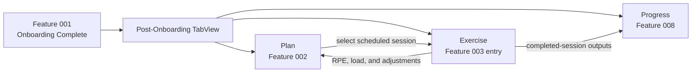
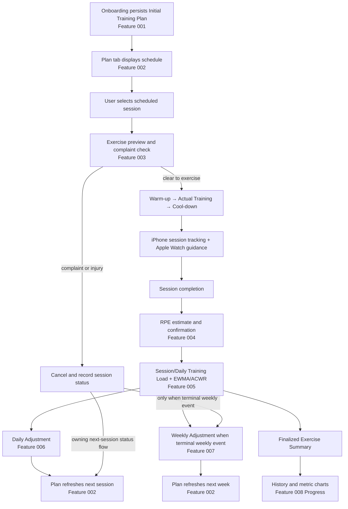
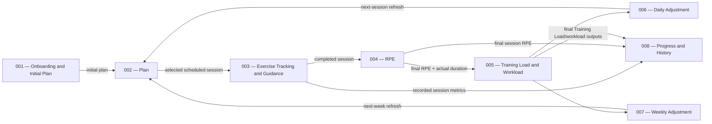

# Kurin Product Workflow and Feature Portfolio

> **Document type:** Portfolio-level product workflow, feature index, documentation-status register, and dependency map
> **Prepared by:** `@planner`
> **Status:** Current as of 2026-11-11
> **Authority:** Repository documentation state plus explicit user approvals dated 2026-11-11

## 1. Purpose and Boundary

This document provides one portfolio-level view of Kurin after onboarding. It describes the three-tab product
experience, the complete exercise lifecycle, the adaptive-training feedback loop, cross-feature data movement,
stable feature ownership, and documentation maturity.

The active IDs were renumbered by explicit user decision on 2026-11-11 so the Training Plan Dashboard follows
onboarding as Feature 002. The same user decision approved a three-tab post-onboarding interface—**Plan**,
**Exercise**, and **Progress**—and established Feature 008 for persistent training progress and session history.

This file is **not** a cross-feature implementation roadmap. It contains no implementation phases, builder tasks,
branch instructions, file maps, or implementation approval. It does not replace or bypass the required per-feature
sequence:

```text
requirement.md approved
  → spec.md approved
    → feature-scoped roadmap and next phase approved
      → builder handoff
```

Each active feature must retain its own approved artifacts under `docs/Feature/<feature-id>-<feature-slug>/` and
`docs/Plan/<feature-id>-<feature-slug>/`. A status in this document is descriptive only; it grants no downstream
approval.

## 2. Approved Portfolio Decisions

The following product-level decisions were explicitly approved by the user on 2026-11-11:

1. After onboarding, the iOS app uses a `TabView` with the visible tabs **Plan**, **Exercise**, and **Progress**.
2. **Plan** presents the authoritative weekly plan and the results of RPE, Training Load, ACWR, and daily/weekly
   adjustment workflows. The Plan UI does not own or repeat those calculations; Features 004–007 remain their
   authoritative owners.
3. **Exercise** presents the selected or next scheduled workout, records the session in a Strava/Runna-style
   tracking experience, and coordinates live Apple Watch guidance. A scheduled session selected in Plan enters this
   Exercise workflow.
4. **Progress** is the tab name for Feature 008, **Training Progress and Session History**. It presents persistent
   completed-session history, individual session details, and selectable charts for Training Load, calories burned,
   steps, and distance, grouped by week, month, or year.
5. Progress analytics are derived from recorded Kurin exercise sessions. They do not represent unrelated activity
   outside Kurin sessions.

Exact metric quantities, unavailable-data behavior, aggregation formulas, device recording ownership, and visual
interaction details remain subject to the sequential requirement and specification gates of the owning features.

## 3. Post-Onboarding App Navigation

Feature 001 completes onboarding, persists the assigned Training Type and Initial Training Plan, and opens the
post-onboarding app shell with **Plan** as the initial destination.



### 3.1. Plan Tab

The Plan tab is the user's schedule and adaptive-plan destination. It shows the current Monday–Sunday plan, session
status, available workload state, and authoritative adjustment results. Selecting a scheduled session transitions
the user into the Exercise workflow for that session.

### 3.2. Exercise Tab

The Exercise tab is the session execution destination. It shows the selected scheduled workout or the next eligible
scheduled workout, performs the pre-exercise flow, records the workout, and coordinates the live guidance experience
with Apple Watch.

### 3.3. Progress Tab

The Progress tab is the persistent history and trend destination. It lets the user browse completed Kurin sessions,
inspect one session, select a metric card, and view the chosen metric over week, month, or year groupings.

## 4. Plan Tab Workflow

The Plan workflow preserves a single authoritative plan state:

1. Feature 001 supplies the Initial Training Plan after onboarding.
2. Feature 002 renders the current plan and session statuses without recalculating or manually overriding them.
3. The user selects a scheduled session and enters Feature 003 through the Exercise tab.
4. After the session, Features 004 and 005 establish final RPE, Training Load, EWMA, and ACWR outputs.
5. Features 006 and 007 apply the eligible daily and weekly decisions.
6. Feature 002 refreshes the displayed current or next-week plan from those authoritative outputs.

This ownership preserves the approved read-only Feature 002 boundary in
`docs/Feature/002-training-plan-dashboard/requirement.md` while still making adaptive results visible in Plan.
The recurring plan and adjustment order is sourced from `docs/guide/04-weekly-training-plan.md` §4.7 and
`docs/guide/14-end-to-end-training-flow.md` Phases 7–10.

## 5. Exercise Tab and Apple Watch Workflow

The Exercise workflow owns session preparation, execution, tracking, and completion coordination:

1. **Session selection:** Receive the scheduled session selected from Plan, or present the next eligible scheduled
   session when Exercise is opened directly.
2. **Session preview:** Present the Training Type, target duration, and phase breakdown.
3. **Complaint check:** Before Warm-up, ask whether the user has a physical complaint or injury. A positive response
   cancels and records the session through the owning session-status flow; a negative response starts Warm-up.
4. **Live workout:** Progress through Warm-up, Actual Training, and Cool-down while recording the Kurin exercise
   session and its available metrics.
5. **Watch guidance:** Coordinate Apple Watch audio and haptic cues for session start, phase transitions, completion,
   and HR Zone 2 pacing guidance. These behaviors are sourced from
   `docs/guide/06-exercise-guidance-system.md` §§6.1–6.3 plus the approved 2026-11-11 Apple Watch decision.
6. **Completion:** End automatically at target duration, end manually, or continue when the approved extension flow
   applies, following `docs/guide/07-exercise-session-start-completion.md` §§7.2–7.4.
7. **Post-session processing:** Pass the completed session to RPE confirmation, Training Load calculation, workload
   evaluation, and adaptive adjustments before presenting the finalized summary.

The immediate post-workout Exercise Summary remains part of the completion flow described in
`docs/guide/07-exercise-session-start-completion.md` §7.5. Feature 008 differs by providing persistent cross-session
history and trends from the finalized session records.

## 6. Progress Tab Workflow

Feature 008, **Training Progress and Session History**, consumes finalized Kurin session outputs without owning the
recording, RPE, or workload calculations that produce them.

### 6.1. Session History

1. Load completed Kurin exercise sessions in a navigable history.
2. Present enough session information for the user to identify and select a workout.
3. Open an individual session detail using the finalized recorded metrics and Training Load outputs.
4. Keep cancelled, incomplete, or unavailable-data behavior subject to the Feature 008 requirement gate.

### 6.2. Metric Selection

The Progress overview provides component cards for these session-derived metrics:

- Training Load.
- Calories burned.
- Steps.
- Distance.

Selecting a metric card changes the active chart. The interaction is conceptually similar to a Runna
workout/progress page but must use Kurin's own approved design system and feature requirements.

### 6.3. Time Grouping

The active metric chart can be grouped by:

- Week.
- Month.
- Year.

The charts use only data attributable to recorded Kurin sessions. Exact calendar boundaries, aggregation operations,
units, rounding, missing samples, and partial-period behavior must be defined and approved in Feature 008's future
`requirement.md` and `spec.md`; this portfolio document does not invent them.

## 7. Complete End-to-End Session Workflow



The RPE, load, summary, and adjustment ordering follows `docs/guide/14-end-to-end-training-flow.md` Phases 5–10.
The final RPE must exist before Training Load, and finalized calculations precede the Exercise Summary, as defined by
`docs/guide/09-training-load.md` §9.1, `docs/guide/14-end-to-end-training-flow.md` Phase 6, and
`docs/guide/07-exercise-session-start-completion.md` §7.5.

## 8. Adaptive Training Feedback Loop



Feature 002 first presents the Initial Training Plan produced by Feature 001. It later receives authoritative
next-session and next-week updates from Features 006 and 007. Feature 008 consumes the finalized exercise record for
history and visualization but does not alter the adaptive plan.

## 9. Cross-Feature Data Flow

| Producer | Output | Consumer | Purpose |
|---|---|---|---|
| Feature 001 | Assigned Training Type and Initial Training Plan | Feature 002 | Establish the first Plan tab state. |
| Feature 002 | Selected scheduled-session identity and prescription | Feature 003 | Open the correct workout in Exercise. |
| Feature 003 | Recorded session, actual duration, completion/status data, and available session metrics | Features 004, 005, 006, 007, and 008 | Drive post-session evaluation, adjustments, history, and charts. |
| Feature 004 | Final confirmed RPE | Features 005, 006, 007, and 008 | Calculate load, select adjustment magnitude, and present finalized session detail. |
| Feature 005 | Session/Daily Training Load, EWMA, ACWR availability/value/category | Features 006, 007, 002, and 008 | Drive adjustment decisions and present workload results/trends. |
| Feature 006 | Next-session Maintain, Decrease, or Rest result | Feature 002 | Refresh the next scheduled Plan session. |
| Feature 007 | Weekly decision and generated next-week plan | Feature 002 | Refresh the next calendar week's Plan. |
| Features 003–005 | Finalized Kurin session record | Feature 008 | Populate history, details, metric cards, and week/month/year charts. |

## 10. Feature and Documentation Status

| ID | Feature | Responsibility | Dependency | Documentation status | Requirement path / status | Specification path / status | Roadmap path / status |
|---:|---|---|---|---|---|---|---|
| `001` | Integrated Onboarding, Health Profile, Assessment, and Initial Plan | Health screening, profile and goal setup, Training Type Assignment, schedule configuration, and Initial Training Plan persistence. | None | Requirement and specification approved; implementation planning exists but remains Draft and blocked. | [`docs/Feature/001-onboarding-health-profile/requirement.md`](../Feature/001-onboarding-health-profile/requirement.md) — **Approved 2026-11-10** | [`docs/Feature/001-onboarding-health-profile/spec.md`](../Feature/001-onboarding-health-profile/spec.md) — **Approved 2026-11-10** | [`docs/Plan/001-onboarding-health-profile/roadmap.md`](001-onboarding-health-profile/roadmap.md) — **Draft**; all listed phases Draft |
| `002` | Training Plan Dashboard (Plan) | Read-only presentation of the Initial Training Plan, current and generated next-week plans, session status, HealthKit vital cards, workload state, and adjustment rationale; entry to a selected Exercise session. | Feature 001 for initial entry; Features 006 and 007 for adjustment refreshes; HealthKit and session-status outputs | Requirement is Draft while calorie, HealthKit prompt, initial workload-state, and Plan-to-Exercise navigation reconciliation remain open. | [`docs/Feature/002-training-plan-dashboard/requirement.md`](../Feature/002-training-plan-dashboard/requirement.md) — **Draft; open decisions and portfolio reconciliation pending** | `docs/Feature/002-training-plan-dashboard/spec.md` — **Not permitted until requirement approval** | `docs/Plan/002-training-plan-dashboard/roadmap.md` — **Not permitted until requirement and specification approval** |
| `003` | Exercise Session Tracking and Guidance (Exercise) | Scheduled-session preparation, exercise recording, phase execution, general guidance, HR Zone 2 guidance, and Apple Watch audio/haptic coordination. | Feature 002 scheduled-session selection and Feature 001 assigned Training Type | Guide-defined plus portfolio decision; feature documentation has not been authored or approved. | `docs/Feature/003-exercise-session-guidance/requirement.md` — **Missing** | `docs/Feature/003-exercise-session-guidance/spec.md` — **Missing** | `docs/Plan/003-exercise-session-guidance/roadmap.md` — **Missing** |
| `004` | RPE Estimation and Confirmation | Automated HRR-based RPE estimate, missing-input fallback, and user confirmation or adjustment. | Feature 003 completed-session output | Guide-defined only; feature documentation has not been authored or approved. | `docs/Feature/004-rpe-estimation/requirement.md` — **Missing** | `docs/Feature/004-rpe-estimation/spec.md` — **Missing** | `docs/Plan/004-rpe-estimation/roadmap.md` — **Missing** |
| `005` | Training Load and Workload Metrics | Session and Daily Training Load, acute/chronic EWMA, ACWR availability, value, category, and rationale. | Feature 004 final RPE and actual session duration | Guide-defined only; feature documentation has not been authored or approved. | `docs/Feature/005-training-load-workload/requirement.md` — **Missing** | `docs/Feature/005-training-load-workload/spec.md` — **Missing** | `docs/Plan/005-training-load-workload/roadmap.md` — **Missing** |
| `006` | Daily Training Adjustment | Apply the latest eligible workload and completed-session RPE outcome to the next scheduled session, then refresh Feature 002. | Feature 005 workload output | Guide-defined only; feature documentation has not been authored or approved. | `docs/Feature/006-daily-training-adjustment/requirement.md` — **Missing** | `docs/Feature/006-daily-training-adjustment/spec.md` — **Missing** | `docs/Plan/006-daily-training-adjustment/roadmap.md` — **Missing** |
| `007` | Weekly Training Adjustment | Evaluate weekly adherence, workload, and causes; produce the next-week Training Plan and refresh Feature 002. | Feature 005 workload output; session adherence and cause data | Guide-defined only; feature documentation has not been authored or approved. | `docs/Feature/007-weekly-training-adjustment/requirement.md` — **Missing** | `docs/Feature/007-weekly-training-adjustment/spec.md` — **Missing** | `docs/Plan/007-weekly-training-adjustment/roadmap.md` — **Missing** |
| `008` | Training Progress and Session History (Progress) | Persistent completed-session history and details; selectable Training Load, calories, steps, and distance charts grouped by week, month, or year using Kurin session data. | Finalized session outputs from Features 003–005 | Portfolio scope approved; feature documentation has not been authored or approved. | `docs/Feature/008-training-progress-session-history/requirement.md` — **Missing** | `docs/Feature/008-training-progress-session-history/spec.md` — **Missing** | `docs/Plan/008-training-progress-session-history/roadmap.md` — **Missing** |

## 11. Approval and Status Rules

- `Approved` applies only when the corresponding artifact records explicit user approval.
- `Ready for Review` is not approval and authorizes no specification, roadmap, phase, or implementation work.
- `Missing` means the expected artifact has not been authored; guide coverage or portfolio approval alone is not
  builder-facing feature documentation.
- Training Type Assignment and Initial Training Plan generation remain integrated into Feature 001 and have no
  standalone feature IDs.
- The three-tab navigation and portfolio-level Feature 008 scope are approved product decisions, but Feature 008
  implementation remains blocked until its own requirement, specification, roadmap, and phase gates are completed.
- A feature-scoped roadmap may be created only after that feature's requirement and specification are explicitly
  approved in order.
- Builder handoff requires an approved current phase in the matching feature-scoped roadmap; this portfolio document
  can never serve as a builder handoff artifact.

## 12. Current Portfolio Summary

- **Approved feature definition:** Feature 001 requirement and specification.
- **Draft implementation planning:** Feature 001 roadmap and its existing phase plans.
- **Draft requirement with open product decisions and portfolio reconciliation:** Feature 002.
- **Guide-defined, documentation not started:** Features 003–007.
- **Portfolio scope approved, feature documentation not started:** Feature 008.
- **Approved post-onboarding navigation:** Plan, Exercise, and Progress tabs.
- **No cross-feature implementation approval:** This document establishes workflow and ownership only.
