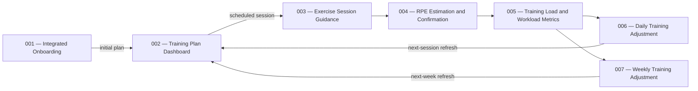

# Kurin Feature Portfolio Index

> **Document type:** Portfolio-level feature index, documentation-status register, and dependency map
> **Prepared by:** `@planner`
> **Status:** Current as of 2026-11-11
> **Authority:** Repository documentation state plus explicit user request dated 2026-11-11

## 1. Purpose and Boundary

This file provides one portfolio-level view of Kurin's stable feature IDs, responsibilities, dependencies, and
documentation maturity. It exists to make the complete product sequence and adjustment feedback loops visible.
The active IDs were renumbered by explicit user decision on 2026-11-11 so the Training Plan Dashboard follows
onboarding as Feature 002.

This file is **not** a cross-feature implementation roadmap. It contains no implementation phases, builder tasks,
branch instructions, file maps, or implementation approval. It does not replace or bypass the required per-feature
sequence:

```text
requirement.md approved
  → spec.md approved
    → feature-scoped roadmap and next phase approved
      → builder handoff
```

Each active feature must retain its own approved artifacts under `docs/Feature/<feature-id>-<feature-slug>/` and
`docs/Plan/<feature-id>-<feature-slug>/`. A status in this index is descriptive only; it grants no downstream
approval.

## 2. Portfolio Dependency Map



Feature 002 first presents the Initial Training Plan produced by Feature 001. It then receives authoritative
next-session and next-week updates from Features 006 and 007. The dashboard does not absorb session execution,
RPE, workload calculation, or adjustment responsibilities from Features 003–007.

## 3. Feature and Documentation Status

| ID | Feature | Responsibility | Dependency | Documentation status | Requirement path / status | Specification path / status | Roadmap path / status |
|---:|---|---|---|---|---|---|---|
| `001` | Integrated Onboarding, Health Profile, Assessment, and Initial Plan | Health screening, profile and goal setup, Training Type Assignment, schedule configuration, and Initial Training Plan persistence. | None | Requirement and specification approved; implementation planning exists but remains Draft and blocked. | [`docs/Feature/001-onboarding-health-profile/requirement.md`](../Feature/001-onboarding-health-profile/requirement.md) — **Approved 2026-11-10** | [`docs/Feature/001-onboarding-health-profile/spec.md`](../Feature/001-onboarding-health-profile/spec.md) — **Approved 2026-11-10** | [`docs/Plan/001-onboarding-health-profile/roadmap.md`](001-onboarding-health-profile/roadmap.md) — **Draft**; all listed phases Draft |
| `002` | Training Plan Dashboard | Read-only presentation of the Initial Training Plan, current and generated next-week plans, session status, HealthKit vital cards, ACWR status, and adjustment rationale. | Feature 001 for initial entry; Features 006 and 007 for adjustment refreshes; HealthKit and session-status outputs | Requirement is Draft while calorie, HealthKit prompt, and initial workload-state decisions remain open. | [`docs/Feature/002-training-plan-dashboard/requirement.md`](../Feature/002-training-plan-dashboard/requirement.md) — **Draft; open decisions pending** | `docs/Feature/002-training-plan-dashboard/spec.md` — **Not permitted until requirement approval** | `docs/Plan/002-training-plan-dashboard/roadmap.md` — **Not permitted until requirement and specification approval** |
| `003` | Exercise Session Guidance | Scheduled-session preparation, exercise-phase execution, general guidance, and HR Zone 2 guidance. | Feature 002 scheduled-session selection and Feature 001 assigned Training Type | Guide-defined only; feature documentation has not been authored or approved. | `docs/Feature/003-exercise-session-guidance/requirement.md` — **Missing** | `docs/Feature/003-exercise-session-guidance/spec.md` — **Missing** | `docs/Plan/003-exercise-session-guidance/roadmap.md` — **Missing** |
| `004` | RPE Estimation and Confirmation | Automated HRR-based RPE estimate, missing-input fallback, and user confirmation or adjustment. | Feature 003 completed-session output | Guide-defined only; feature documentation has not been authored or approved. | `docs/Feature/004-rpe-estimation/requirement.md` — **Missing** | `docs/Feature/004-rpe-estimation/spec.md` — **Missing** | `docs/Plan/004-rpe-estimation/roadmap.md` — **Missing** |
| `005` | Training Load and Workload Metrics | Session and Daily Training Load, acute/chronic EWMA, ACWR availability, value, category, and rationale. | Feature 004 final RPE and actual session duration | Guide-defined only; feature documentation has not been authored or approved. | `docs/Feature/005-training-load-workload/requirement.md` — **Missing** | `docs/Feature/005-training-load-workload/spec.md` — **Missing** | `docs/Plan/005-training-load-workload/roadmap.md` — **Missing** |
| `006` | Daily Training Adjustment | Apply the latest eligible workload and completed-session RPE outcome to the next scheduled session, then refresh Feature 002. | Feature 005 workload output | Guide-defined only; feature documentation has not been authored or approved. | `docs/Feature/006-daily-training-adjustment/requirement.md` — **Missing** | `docs/Feature/006-daily-training-adjustment/spec.md` — **Missing** | `docs/Plan/006-daily-training-adjustment/roadmap.md` — **Missing** |
| `007` | Weekly Training Adjustment | Evaluate weekly adherence, workload, and causes; produce the next-week Training Plan and refresh Feature 002. | Feature 005 workload output; session adherence and cause data | Guide-defined only; feature documentation has not been authored or approved. | `docs/Feature/007-weekly-training-adjustment/requirement.md` — **Missing** | `docs/Feature/007-weekly-training-adjustment/spec.md` — **Missing** | `docs/Plan/007-weekly-training-adjustment/roadmap.md` — **Missing** |

## 4. Approval and Status Rules

- `Approved` applies only when the corresponding artifact records explicit user approval.
- `Ready for Review` is not approval and authorizes no specification, roadmap, phase, or implementation work.
- `Missing` means the expected artifact has not been authored; guide coverage alone is not builder-facing feature
  documentation.
- Training Type Assignment and Initial Training Plan generation remain integrated into Feature 001 and have no
  standalone feature IDs after the approved 2026-11-11 renumbering.
- A feature-scoped roadmap may be created only after that feature's requirement and specification are explicitly
  approved in order.
- Builder handoff requires an approved current phase in the matching feature-scoped roadmap; this portfolio index
  can never serve as a builder handoff artifact.

## 5. Current Portfolio Summary

- **Approved feature definition:** Feature 001 requirement and specification.
- **Draft implementation planning:** Feature 001 roadmap and its existing phase plans.
- **Guide-defined, documentation not started:** Features 003–007.
- **Draft requirement with open product decisions:** Feature 002.
- **No cross-feature implementation approval:** This index changes navigation and visibility only.
